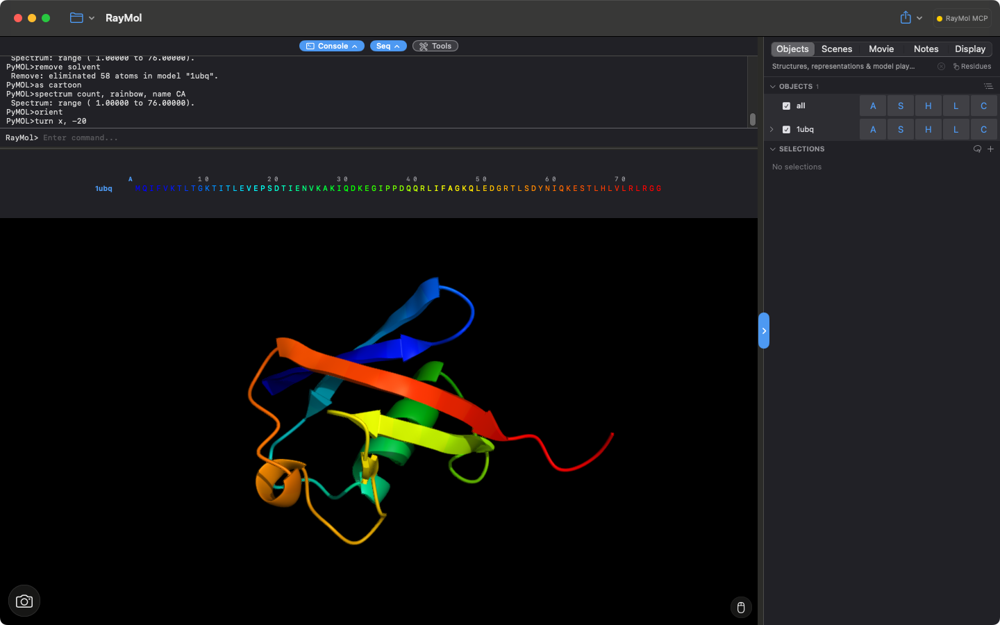
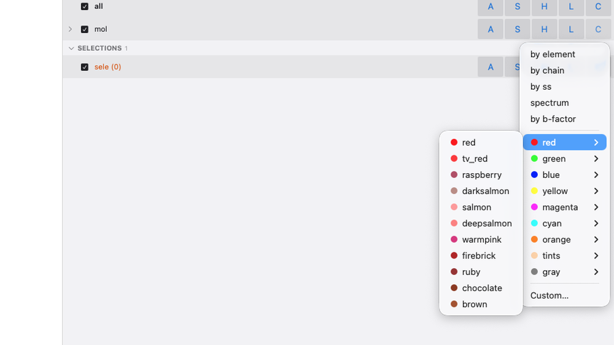
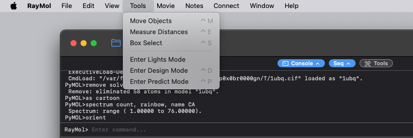
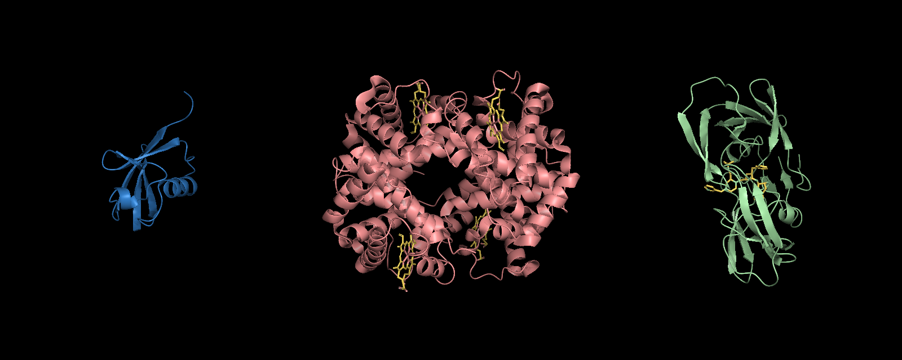
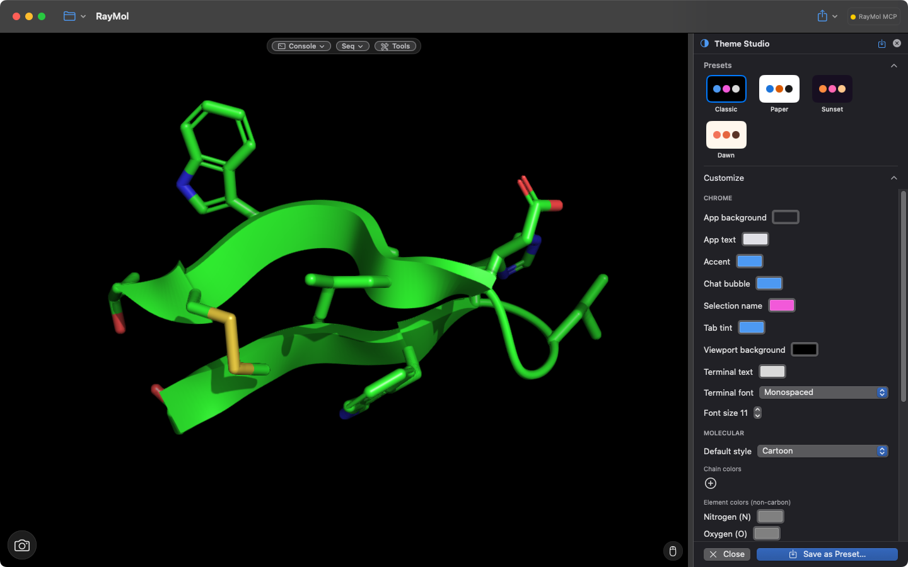

RayMol provides a native macOS, iPadOS, and iOS interface designed for structural biology. It pairs a high-performance Metal 3D graphics engine with native SwiftUI controls and an embedded PyMOL core.

## The Window Layout

On macOS and iPad (landscape), the window is divided into three main operational areas:

*The RayMol window: top rail with Console / Seq / Tools pills, console and sequence panes, the 3D viewport, and the Inspector (Objects tab) on the right.*

1. **Top Rail & Toolbar**: Houses file operations (**Open** and **Export** on macOS; **Open**, **Save**, **Export** on iPad and iPhone), pane visibility pills (**Console**, **Seq**, **Tools**), and active background task indicators.
2. **3D Viewport**: The central canvas where molecular structures are rendered, selected, and transformed.
3. **Inspector Panel**: The collapsible right-hand column featuring tabbed access to objects, scenes, movies, analysis notes, and display settings.

:::note[Platform adaptation]
On iPhone and iPad (portrait), the interface adapts into a vertical layout. The 3D viewport occupies the top portion of the screen, and the inspector tabs appear as a bottom sheet with an integrated tab bar.
:::

## 3D Viewport

The viewport provides hardware-accelerated rendering powered by Apple Metal:

- **Touch and gesture navigation**: Rotate with single-finger drag or left-click drag; pan with two-finger drag or middle-click drag; zoom with pinch or right-click drag; roll with a two-finger twist (iOS, or the macOS Trackpad mouse mode); and adjust slab clipping with a three-finger drag (iOS) or Shift + right-drag / Shift + two-finger trackpad drag (macOS).
- **Drag-and-drop loading**: On macOS, drag `.pdb`, `.cif`, `.mmcif`, or `.pse` files from Finder onto the viewport to load them into the current session.
- **Hover readout chip**: Displays the identifier of the atom, residue, chain, or object currently under the pointer in the upper-right corner of the viewport.
- **Hover indicator**: Subtly highlights the targeted residue in cyan before clicking, allowing accurate picking without altering existing selections.
- **Camera dock**: Tap the camera button at the bottom-left of the viewport to open **Lens** (35 mm-equivalent, with an **Ortho** toggle), **Zoom**, and **Depth** (depth of field).

## Inspector Sections

The inspector groups session controls into five tabs accessible via the segmented switcher (macOS and iPad) or bottom tab bar (iPhone):

- **Objects**: Lists loaded structures, molecular groups, named selections, and sequence alignments. Provides per-object visibility toggles and representation menus.
- **Scenes**: Stores and recalls camera angles, representations, and object positions. Includes an option to display glanceable scene buttons directly in the viewport.
- **Movie**: Authors camera keyframes, scene transitions, and multi-state trajectory animations using the timeline panel.
- **Notes**: A Markdown laboratory notebook linked to the active session. Embeds interactive camera links, scene snapshots, and structural residue contacts.
- **Display**: Configures canvas parameters, background color, lighting rigs, depth of field, outlines, shadows, real-time ambient occlusion, and [Theme Studio](#theme-studio).

## Object Rows & Action Menus

Each molecular structure in the **Objects** inspector is represented by a row containing a visibility checkbox, the object name, and five dedicated action buttons: **A**, **S**, **H**, **L**, and **C**.

*The **C** menu of an object row.*

- **Visibility checkbox**: Tapping the checkbox or row title toggles rendering on or off (`enable` / `disable`).
- **All row**: Positioned at the top of the list to simultaneously toggle or modify every loaded object in the session.
- **A (Action)**: Manages object lifecycle, camera centering (**Zoom**, **Center**, **Orient**), standard presets (**Pretty**, **Publication**, **Ball and stick**), contact analysis (**Find polar contacts**, **Salt bridges**, **Halogen bonds**), structural alignment, hydrogen manipulation, and physical property computation.
- **S (Show)**: Displays molecular representations, including **Cartoon**, **Sticks**, **Spheres**, **Surface**, **Side chains**, **Ribbon**, **Mesh**, **Dots**, and **Labels**.
- **H (Hide)**: Selectively hides individual representations or cleans up the view with **Everything**.
- **L (Label)**: Attaches 3D labels to atoms, residues, chains, or properties.
- **C (Color)**: Colors atoms by element, chain, secondary structure, B-factor, spectrum ramps, or curated uniform color palettes.

## Hierarchical Groups

Organize complex assemblies into collapsible groups using the `group` command or **A ▸ Move to Group ▸ New Group…**:

- Groups display an expandable disclosure chevron and indented child rows (groups can nest; indentation stops increasing after three levels).
- The group visibility checkbox provides a three-state indicator: checked (all children enabled), empty (all children hidden), or mixed (some children visible).
- Group action menus permit bulk camera framing, ungrouping, or deleting the entire collection.

## Sequence Panel

Open the sequence panel by clicking the **Seq** rail pill, choosing **View ▸ Show Sequence**, or pressing `⌘2`.

- The panel docks directly above the viewport and displays one-letter amino acid and nucleic acid sequences grouped by chain.
- Click or drag across residues in the sequence strip to create or expand the active selection.
- The panel height can be resized by dragging the splitter hairline between the sequence viewer and the viewport.

## Command Console

Access the integrated PyMOL and Python terminal by clicking the **Console** rail pill, choosing **View ▸ Show Console**, or pressing `⌘1`.

- **Log & Input**: Displays command output, error traces, and script execution logs. Enter native PyMOL commands or Python one-liners directly at the prompt.
- **History & Autocomplete**: Press `↑` and `↓` to cycle through command history; press `Tab` to complete command names and object identifiers (on iPad and iPhone, use the ↑ and ⇥ buttons beside the input).
- **Smart punctuation normalization**: Automatically converts iOS and iPadOS curly quotes and em dashes back to ASCII quotes and hyphens so scripts run without syntax errors.
- **Resizable divider**: Drag the divider bar beneath the console to expand the log viewing area.

## Tools Menu & Interaction Modes

The **Tools** menu (macOS menu bar) and the toolbar **Tools** button's menu house RayMol's interaction modes. Entering any mode temporarily reassigns viewport pointer actions:

*The Tools menu (menu bar) with the interaction modes and their shortcuts.*

- **Move Objects (`⌃M`)**: Displays a 3D coordinate gizmo to translate and rotate individual structures in space.
- **Measure Distances (`⌃E`)**: Accumulates viewport atom picks to compute distances, angles, and dihedral torsions.
- **Box Select**: Draws a 2D rectangle to select enclosed atoms. Box Select is in the macOS **Tools** menu (`⌃S`) and, on any platform, behind the lasso icon in the **Selections** header; it is not in the toolbar **Tools** button's menu.
- **Lights Mode** (beta, not yet released): Activates direct manipulation of scene lighting angles, spot direction, and atmosphere via **Tools ▸ Enter Lights Mode** (macOS) or **Lights** in the toolbar Tools button's menu.
- **Enter Design Mode (`⌃D`)**: Launches on-device ProteinMPNN sequence design and mutation scoring (requires iOS 18+ on iPhone/iPad).
- **Enter Predict Mode (`⌃P`)**: Runs on-device structure prediction (requires iOS 18+ on a physical iPhone/iPad device).

Pressing `Esc` (macOS) or clicking the mode banner's close button returns the viewport to standard viewing mode.

## Hover Readout & Progress Tray

- **Hover Readout Chip**: Positioned in the upper-right corner of the canvas. Reports the atom name, residue number, chain, and parent object under the pointer according to the active selection granularity.
- **Progress Tray**: Sits above the viewport to track non-blocking background operations, including model weight downloads, structure predictions and design runs. Tasks can be canceled directly from the tray.

## Grid Mode

Enable multi-structure comparison by turning on **Grid** in the Display tab's **Canvas** group, or `set grid_mode, 1`:

*Grid mode: each object drawn in its own cell with a shared camera.*

- Rather than superimposing all structures at a common origin, Grid Mode tiles each loaded object into its own discrete viewport cell.
- Camera transformations and lighting interactively synchronize across grid cells, simplifying comparative analysis of homologs and conformational ensembles.

## Theme Studio

Customize RayMol's visual appearance by selecting **Theme Studio…** in the **Display** inspector tab:

*Theme Studio.*

- **Application chrome**: Customize accent colors, inspector backgrounds, tab tints, and console text colors and fonts.
- **Molecular styling**: Adjust default chain cycle palettes, heteroatom element colors, and default representations (Cartoon, Sticks, Spheres, Ball & Stick, Surface).
- **Renderer defaults**: Toggle silhouettes, flat beta-sheets, fancy helices, and real-time shadows and ray tracing.
- Save custom styling as reusable presets or restore factory themes at any time.

## Context Menus

Right-clicking (macOS) or long-pressing (iOS/iPadOS) in the viewport reveals a contextual action sheet:

- **Over an atom or residue**: Provides quick options to **Zoom to residue**, **Select residue**, **Label residue**, **Hide residue**, **Center here**, **Auto-lock focus**, or apply a quick **Color**.
- **Over empty space**: Offers one-tap actions to **Reset view** or **Deselect all**.

To learn more about selecting and transforming molecules, see [Selecting, Measuring & Moving](/RayMol/guides/selecting/).
