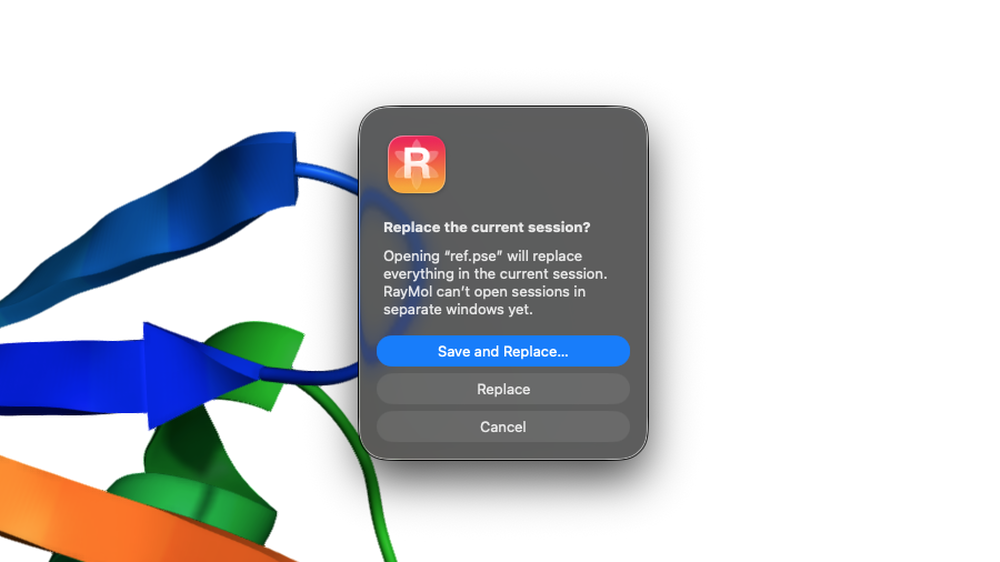

This walkthrough introduces the essential workflow in RayMol: fetching a structure, navigating representations, making selections, taking measurements, refining lighting and materials, and exporting your final figure.

---

## 1. Load a structure

There are three quick ways to bring a molecular structure into RayMol:

### Command Console
Press `⌘1` (or click the **Console** pill in the top rail) to toggle the built-in command prompt, then fetch a structure directly from the RCSB Protein Data Bank:

```text
fetch 1ubq, async=0
```

RayMol downloads ubiquitin (`1ubq`) and loads it into the 3D viewport.

### File menu
Choose **File ▸ Fetch from PDB…** (`⇧⌘O`) to enter a 4-letter PDB ID, or choose **File ▸ Open…** (`⌘O`) to open local `.pdb`, `.cif`, `.mmcif`, `.sdf`, or `.pse` files.

### Drag and drop
Drag any supported structure file from macOS Finder directly onto the RayMol 3D viewport. A blue highlight indicates the drop target.

:::tip
On iPad and iPhone, tap the folder icon (**Open**) in the toolbar to import structures from the Files app, or tap **Fetch from PDB…** on the empty-viewport screen.
:::

---

## 2. Navigate the interface and Inspector

RayMol's main window is organized into the Metal 3D viewport on the left and the **Inspector** sidebar on the right (or bottom in mobile portrait).

The Inspector features five functional tabs:

- **Objects:** Structures, selections, multi-state models, and alignments.
- **Scenes:** Store and recall camera angles and representations.
- **Movie:** Keyframe animation, scenes, and camera tracks.
- **Notes:** Session-linked observations and analysis notes.
- **Display:** Canvas, lighting, shadows, ray tracing, and post-processing effects.

Switch between tabs by clicking the segmented switcher at the top of the Inspector.

```
┌───────────────────────────────────────┬───────────────────────────────────────┐
│  [Console] [Seq]   [Tools ▾]          │ [Objects][Scenes][Movie][Notes][Display]
├───────────────────────────────────────┼───────────────────────────────────────┤
│                                       │ ☝ Residues   ✕ sele                   │
│                                       ├───────────────────────────────────────┤
│                                       │ all         [A][S][H][L][C]           │
│           3D Metal Viewport           │ ▼ OBJECTS (1)                         │
│                                       │   1ubq      [A][S][H][L][C]           │
│                                       │ ▼ SELECTIONS                          │
│                                       │   (No selections)                     │
└───────────────────────────────────────┴───────────────────────────────────────┘
```

---

## 3. Control representations and colors (A / S / H / L / C)

Every object row in the **Objects** inspector carries five action buttons:

- **A (Action):** Preset views, centering, alignment, hydrogen handling, and object duplication or deletion.
- **S (Show):** Display specific representations (cartoon, sticks, spheres, surface, side chains).
- **H (Hide):** Hide representations or selections.
- **L (Label):** Display residue numbers, atom names, elements, or chain identifiers.
- **C (Color):** Color by element, chain, secondary structure, b-factor, spectrum, or named color palette.

The pinned **all** row at the top applies actions across every loaded object simultaneously.

### Try common representations

In the **1ubq** object row:
1. Click **H ▸ everything** to clear the current representation.
2. Click **S ▸ cartoon** to render the protein backbone.
3. Click **S ▸ side chains ▸ as sticks** to display non-backbone residues cleanly attached to the ribbon.
4. Click **C ▸ by chain** (or choose a shade from **C ▸ blues ▸ marine**).

You can also run standard PyMOL commands in the console:

```text
hide everything, 1ubq
show cartoon, 1ubq
show sticks, 1ubq and (sidechain or name CA)
color marine, 1ubq
util.cnc('1ubq')
```

:::note
`util.cnc` colors every non-carbon atom by element (oxygen red, nitrogen blue, sulfur yellow) and leaves carbons in whatever color they already have.
:::

---

## 4. Pick, select, and box-select

RayMol provides precise selection controls directly in the viewport and Inspector.

### Click picking
Click any residue or atom in the viewport. Pink indicator squares appear around selected atoms, and a new `sele` entry appears under the **SELECTIONS** section in the Inspector.

### Selection mode
RayMol controls what a single click selects (atoms, residues, chains, segments, objects, molecules, or C-α).
- Check the current mode next to the tap icon in the Inspector header (defaults to **Residues**).
- On macOS, press `Tab` or `⇧Tab` (with the command line empty) to cycle through selection modes without opening the menu.

### Box select
To select an entire binding pocket or region with a marquee box:
1. On macOS choose **Tools ▸ Box Select** (`⌃S`); on any platform click the lasso icon in the **SELECTIONS** section header.
2. A rubber-band frame appears over the viewport. Drag the edges or corners to enclose your target atoms.
3. Press `Esc` (macOS) or click the **✕** button or the lasso button to exit Box Select.

### Clear selections
- Press `Esc` (macOS) once to deselect atoms; press `Esc` a second time to delete the `sele` selection.
- Alternatively, click the clear button (✕) in the Inspector header.

### Named selections via command
For exact atom selections, use the `select` command:

```text
select hydrophobic, 1ubq and resn ALA+VAL+LEU+ILE+PHE+MET+TRP
color orange, hydrophobic
```

---

## 5. Measure distances and angles

RayMol includes an interactive measurement tool for inspecting distances, angles, and dihedrals:

1. Choose **Tools ▸ Measure Distances** (`⌃E`), or open **Tools** in the top rail and choose **Measure**.
2. A measurement bar appears at the top of the viewport with a segmented picker: **Distance**, **Angle**, and **Dihedral**.
3. With **Distance** selected, click two atoms in the viewport. RayMol draws a dotted measurement dash with the distance in Ångströms.
4. Switch to **Angle** and click three atoms to measure bond angles, or **Dihedral** and click four atoms for torsion angles.
5. Click the trash icon to clear measurements, or press `Esc` (macOS) to exit measure mode.

Equivalent console commands:

```text
distance dist01, 1ubq and resi 1 and name CA, 1ubq and resi 10 and name CA
```

---

## 6. Improve the look: lighting, ray tracing, and materials

RayMol replaces traditional offline rendering with interactive Metal-native lighting and hardware ray tracing.

Switch to the **Display** tab in the Inspector:

### Real-time shadows and ambient occlusion
Shadows and Ambient occlusion are on by default in the **Shadows & AO** group; turn them off or tune them here.

### Hardware ray tracing
On GPUs that support hardware ray tracing, Ray tracing (AO + shadows) under **Metal optimization** is on by default; turn it off or tune it here:
- Traces real-time occlusion rays across the molecular geometry.
- RT hard shadows gives crisp directional cast shadows (on by default).
- Temporal AO accumulates rays while the camera is stationary for noise-free rendering (on by default).

### Apply materials and Looks
RayMol supports physically-based materials including `metallic`, `glass`, `matte`, `clay`, and `marble`.

Apply a pre-tuned material look to your structure using the console:

```text
apply_look gold, 1ubq, cartoon
```

Or configure custom surface materials:

```text
show surface, 1ubq
set surface_material, marble, 1ubq
set transparency, 0.2, 1ubq
```

### Studio environment and effects
- **Outline:** Under **Effects**, toggle **Outline** to draw crisp silhouette lines around objects.
- **Filmic tone-map:** Toggle **Filmic tone-map** for cinematic contrast with soft highlight rolloff.
- **Theme Studio:** Tap **Theme Studio…** at the top of the Display tab to switch between built-in viewport and interface palettes (Classic, Paper, Sunset, Dawn).

---

## 7. Save your session and export figures

### Save a PyMOL session (.pse)
To preserve your molecular state, representations, camera position, and custom colors:


*Opening a `.pse` while you have unsaved work asks before replacing it.*

- Choose **File ▸ Save Session** (`⌘S`) or **File ▸ Save Session As…** (`⇧⌘S`).
- RayMol writes a standard PyMOL `.pse` session file (RayMol-only render settings are ignored by desktop PyMOL).

### Export high-resolution images
Choose **File ▸ Export Image…** (`⇧⌘E`) to save a PNG at 2× the view size, or use the toolbar **Export ▸ Save Image** menu to pick Current View Size, 2× View, 4K · 3840 × 2160 or Custom…. Turn on **Transparent background** in the same Export menu first if you want one.

To quickly copy the current rendering to your clipboard for pasting into presentations or manuscripts, press `⌘C` or choose **File ▸ Copy Image to Clipboard**.

---

## Next steps

- Explore the [Interface Tour](/RayMol/getting-started/interface/) for a detailed breakdown of all panels, gestures, and controls.
- Master [Selecting, Measuring & Moving](/RayMol/guides/selecting/) for complex molecular manipulation.
- Review [Keyboard Shortcuts](/RayMol/reference/keyboard-shortcuts/) to accelerate your daily workflow.
- Set up the [Model Context Protocol](/RayMol/guides/mcp-setup/) to control RayMol directly from Claude Desktop (direct-download macOS build only).
