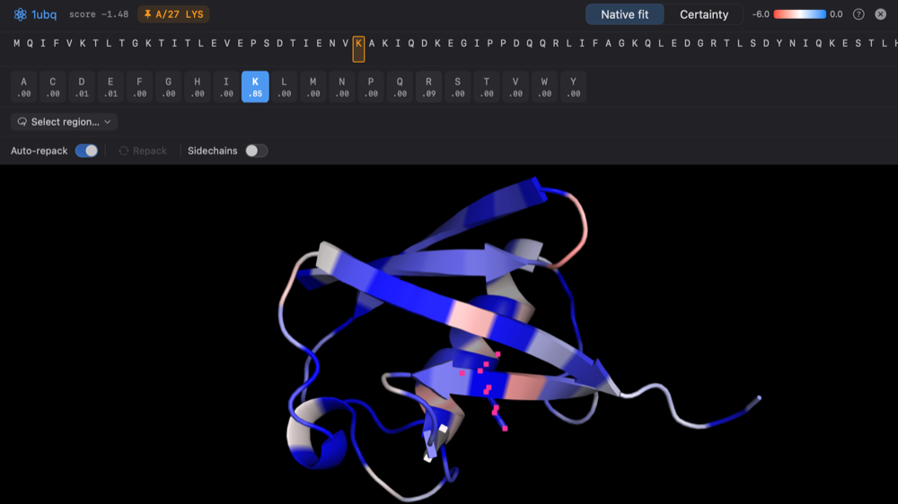
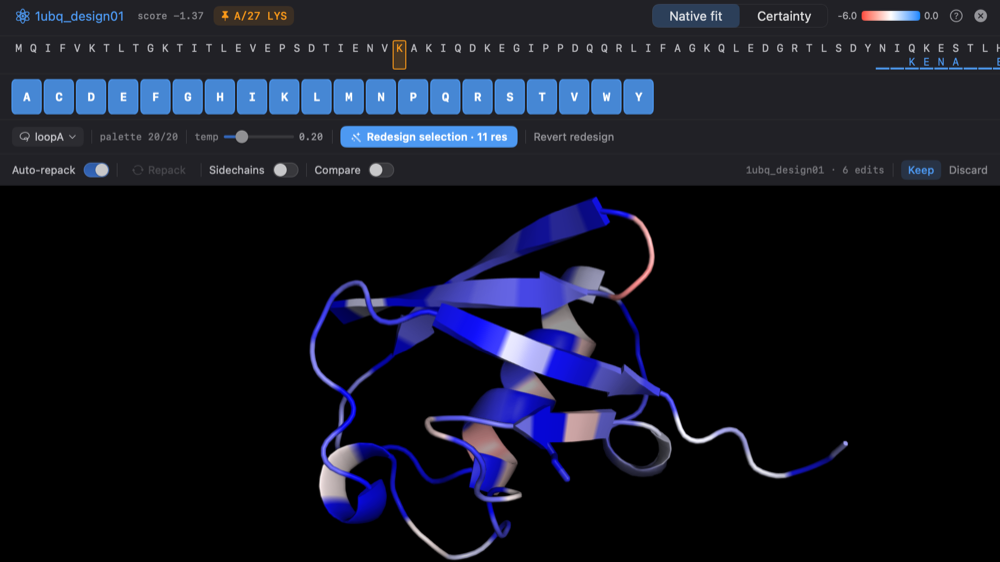

Design mode brings on-device sequence design and inverse folding to RayMol,
powered by an embedded implementation of ProteinMPNN running on Apple Silicon
via MLX. You can score native backbone compatibility, inspect residue
propensities, introduce point mutations with real-time repacking, and redesign
selected structural regions entirely offline.

Enter Design mode by choosing **Tools ▸ Enter Design Mode** or pressing `⌃D`.
On macOS, press `Esc` to leave Design mode (edits are kept, as with **Done**).

:::note[Platform availability]
Design mode is available on **macOS** and physical **iOS 18+** / **iPadOS 18+**
devices with Apple Silicon. The iOS Simulator is not supported.
:::

## How Design mode works

Design mode works directly on structures loaded in your session:

- **100% offline**: Model weights and neural network inference run locally via
  Metal. No sequences or structures are sent over the network.
- **Target selection**: The **Target** field specifies which structure or object
  Design mode operates on. You can type an object name or choose one from the
  dropdown.
- **Region selection**: Region redesign is driven by PyMOL's standard `sele`
  selection. Residues you click in the 3D viewport or select via the sequence viewer
  become part of the redesign target.

When Design mode opens, sidechains on the target structure are displayed as sticks
by default, and residues outside the target object are dimmed.

## Confidence coloring

Design mode scores the target backbone and applies per-residue colors according
to how well the sequence fits the structure:

- **Native fit** (*default*): Measures how well ProteinMPNN thinks each position
  fits the amino acid that is currently present. Colored using a red-white-blue
  diverging palette (red = poor fit, white = neutral, blue = strong native fit).
- **Certainty**: Measures how confident the model is in its own predicted choice
  at that position (calculated as $1 - \text{entropy}/\ln 21$). Colored using a
  blue-white-red palette (blue = low certainty / flat distribution, red = high certainty).

Toggle between coloring schemes in the docked Design panel. These scores are
automatically recorded in the session's [Object Metrics](/RayMol/guides/metrics/)
store under the keys `native_fit` and `certainty`.

## Propensity inspector

Hover over or click to pin any residue in the 3D viewport or sequence strip:


*Design mode: per-residue propensities above a structure colored by native fit.*

- **Propensity bar chart**: Shows the full 20-amino-acid probability distribution
  predicted by ProteinMPNN for that backbone position.
- **Live sidechain preview**: Hovering over an amino acid bar in the inspector
  displays element-colored sticks for that candidate sidechain directly in the
  3D scene without modifying your structure.
- **Pinned residue**: Clicking a residue pins the inspector so you can evaluate
  alternate sidechains without moving the pointer away.

## Point mutations and live repacking

You can mutate individual residues and evaluate their impact immediately:

1. Hover or pin the residue you wish to change.
2. Select the desired amino acid from the propensity inspector.
3. RayMol creates a **working copy** of your structure (e.g. `obj_design`) so
   your original object remains untouched.
4. RayMol instantly rescores the sequence and repacks the mutated sidechain
   with ProteinMPNN's sidechain packer.

### Compare and Keep / Discard

While editing a working copy:

- **Cmp (Compare)**: toggles a comparison against the original structure. Choose
  overlay or a side-by-side view with the **Side-by-side** switch in Design settings.
- **Keep**: Finalizes your mutations and preserves the edited object in your
  session.
- **Discard**: Discards the working copy and restores the original structure.

## Region redesign

To redesign an entire loop, pocket, or binding interface:


*Redesigning a selected region.*

1. Select the desired residues using PyMOL's standard selection syntax (e.g.
   `select sele, resi 45-60`) or by clicking them in the viewport.
2. Under the Design action row, configure amino acid restrictions if desired
   (use the pill row to omit specific residue types like Cys or Pro).
3. Click **Redesign selection**. ProteinMPNN generates sequence candidates for the
   selected region while holding the rest of the protein sequence and backbone
   fixed.
4. Review the newly suggested sequence and its repacked sidechain conformations.
5. Use **Revert redesign** to undo the last region redesign (earlier manual edits are kept).

## Metric persistence

Scored residues and design evaluations are stored permanently with the object in
the RayMol session. You can re-examine, re-color, and export these values at any
time using the [Metrics commands](/RayMol/guides/metrics/):

```text
metrics_get myprotein_design, native_fit
metrics_color native_fit, myprotein_design
```

## Related workflows

- Learn selection commands and modifiers in [Selecting](/RayMol/guides/selecting/).
- Predict 3D structures from newly designed sequences in [Structure Prediction](/RayMol/guides/predict/).
- Export metrics to CSV or JSON in [Metrics](/RayMol/guides/metrics/).
- View all command-line tools in [Commands Reference](/RayMol/reference/commands/).
