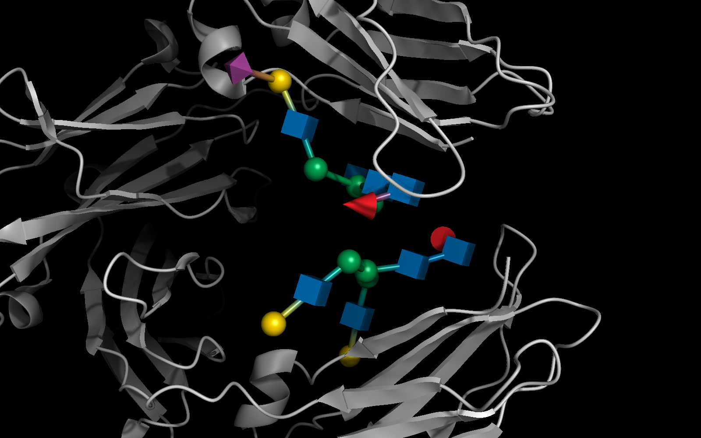
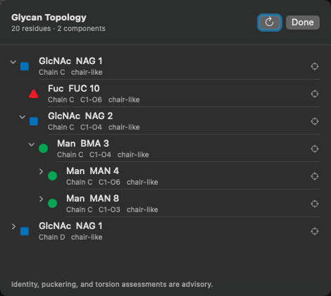

RayMol integrates dedicated glycobiology tools directly into its molecular model and Metal rendering pipeline. Recognized carbohydrate residues can be displayed as three-dimensional Symbol Nomenclature for Glycans (SNFG) shapes or colored using the standard SNFG palette, while the underlying atomic coordinates remain fully interactive and inspectable.

## SNFG conventions & residue catalogue

RayMol adheres to the [Symbol Nomenclature for Glycans (SNFG)](https://www.ncbi.nlm.nih.gov/glycans/snfg.html) standard established by the glycomics community and NCBI. Carbohydrate residues are represented by standardized geometric shapes and colors based on their monosaccharide family.

The built-in catalogue covers the most common mammalian monosaccharides and their chemical-component PDB identifiers:

| PDB Code | Monosaccharide | SNFG Symbol | 3D Shape | Color | Hex Code |
| :--- | :--- | :--- | :--- | :--- | :--- |
| `NAG`, `NDG` | *N*-acetylglucosamine | GlcNAc | Cube | Blue | `#0072BC` |
| `A2G`, `NGA` | *N*-acetylgalactosamine | GalNAc | Cube | Yellow | `#FFD400` |
| `BM3` | *N*-acetylmannosamine | ManNAc | Cube | Green | `#00A651` |
| `MAN`, `BMA` | Mannose | Man | Sphere | Green | `#00A651` |
| `GAL`, `GLA` | Galactose | Gal | Sphere | Yellow | `#FFD400` |
| `GLC`, `BGC` | Glucose | Glc | Sphere | Blue | `#0072BC` |
| `FUC`, `FUL` | Fucose | Fuc | Cone | Red | `#ED1C24` |
| `SIA`, `SLB` | *N*-acetylneuraminic acid | Neu5Ac | Diamond | Purple | `#A54399` |
| `NGC` | *N*-glycolylneuraminic acid | Neu5Gc | Diamond | Light Blue | `#8FCCE9` |

Residue codes not in this table are left untouched; a catalogued residue whose ring atoms are incomplete gets no 3D symbol.

## Rendering SNFG cartoons

When an SNFG cartoon is generated, RayMol computes the centroid and ring normal of each complete sugar ring, renders the corresponding 3D geometric symbol, and traces covalent glycosidic bonds between residues as cylindrical linkers. Linkers reflect true covalent connectivity, not arbitrary spatial proximity.


*SNFG glycan cartoon of a sialylated IgG Fc (PDB 4BYH).*

### From the interface

In the **Objects** panel:
- Open the **S** menu on an object row and choose **Glycan cartoon** to generate the 3D symbols.
- Open the **H** menu on an object row and choose **Glycan cartoon** to remove its 3D symbols and show those sugar residues as sticks.
- Open the **C** menu on an object row and choose **SNFG glycan palette** to color the underlying atomic model according to SNFG standards without generating 3D cartoon shapes.

### From the command line

Run `glycocartoon` and `glycocolor` directly in the command entry bar:

```text
fetch 4byh, async=0
glycocolor 4byh
glycocartoon 4byh
```

To customize cartoon dimensions or linkers, supply the optional arguments:

```text
glycocartoon [selection [, size [, draw_linkers [, state]]]]
```

- **`selection`** (default `"all"`): The target atom selection.
- **`size`** (default `2.5`): The geometric scale of the generated 3D symbols in angstroms.
- **`draw_linkers`** (default `1`): Set to `1` to render connecting cylinders along glycosidic bonds, or `0` to render only the monosaccharide symbols.
- **`state`** (default `1`): Coordinate state index for multi-state objects.

### Hiding cartoons

To remove one cartoon, pass the same selection text you gave `glycocartoon` (e.g. `glycocartoon_hide 4byh` after `glycocartoon 4byh`). If unsure, use `glycocartoon_hide_all`.

```text
glycocartoon_hide 4byh
```

To remove all generated glycan cartoon objects across the entire session and show those sugar residues as sticks:

```text
glycocartoon_hide_all
```

:::tip[Interactive picking]
Clicking a sugar symbol acts like clicking that residue's atoms, so it works with the current selection or measurement mode.
:::

## Inspecting glycan topology & geometry

Complex *N*- and *O*-linked glycans form branched tree structures rooted at protein attachment sites (such as asparagine for *N*-glycosylation or serine/threonine for *O*-glycosylation).

### The Glycan Topology panel

To inspect the glycan forest interactively:


*The Glycan Topology sheet for the IgG Fc N-glycans of 4BYH.*

1. Locate the **OBJECTS** section header in the **Objects** panel.
2. Click the indented-list icon (**Glycan topology**) at the right of the OBJECTS header.
3. The **Glycan Topology** sheet opens, displaying each glycan tree, rooted at the sugar covalently bonded to a non-sugar residue (for example the Asn of an N-glycan) when there is one. The header shows the residue and component counts.

Each node in the topology tree details:
- **Residue:** SNFG symbol, residue name, number and chain.
- **Ring shape:** a coarse puckering class (chair-like, boat/skew-like, envelope/half-chair-like, nearly planar).
- **Linkage:** the bond atoms (e.g. C1-O4).

Numeric Cremer–Pople Q/θ/φ and glycosidic φ/ψ (and ω for 1→6 linkages) are available from the `glyco_tree` command. Clicking any node in the topology list highlights and centers that residue in the 3D viewport.

### Topology commands

The same structural analysis can be invoked from the command bar or Python scripts:

```text
glyco_tree [selection [, state]]
glyco_remediate [selection [, state]]
```

- **`glyco_tree`:** Constructs the covalent glycan tree hierarchy, measures ring puckering parameters, calculates glycosidic torsion angles, and prints the result as JSON (residues, Cremer–Pople Q/θ/φ, linkage φ/ψ/ω).
- **`glyco_remediate`:** Reports, for each residue in the selection, whether its residue code is in RayMol's SNFG catalogue. For unknown codes it says whether the atom names suggest an aldose-like or sialic-acid-like ring. Nothing is changed; output is JSON.

:::note[Advisory geometry]
Puckering classifications and torsion angle assessments are advisory structural metrics. They do not alter coordinates or rewrite PDB residue identities, and should be interpreted in conjunction with experimental electron density or cryo-EM map evidence.
:::
