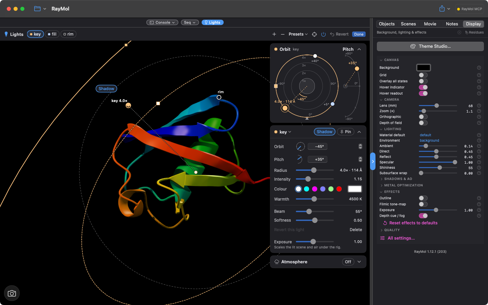
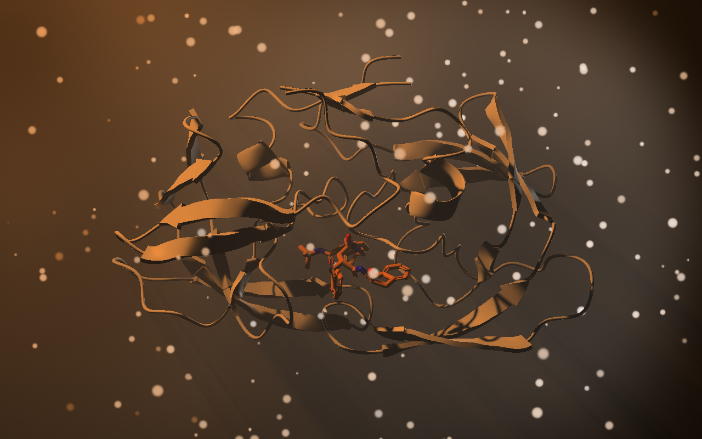

:::caution[Beta]
Studio lights are in beta. They are on RayMol's development branch but not yet in a released version, and the commands, controls and defaults may still change before they ship.
:::

Studio lights introduce a dedicated photography lighting rig to RayMol. Instead of relying solely on PyMOL's fixed camera-relative shading, you can position up to six independent spot lights around your structure, tint them by color temperature or RGB values, cast colored shadows, and illuminate atmospheric haze and floating dust.

:::note
Studio lights and atmospheric scattering are rendered exclusively by RayMol's native Metal engine on macOS, iPadOS, and iOS. The CPU-based `ray` command maintains PyMOL's classic lights.
:::

## Core concepts

- **The rig belongs to the scene:** A rig contains up to six spot lights, up to three of which can cast shadows. The rig never modifies object colors, materials, or atomic coordinates.
- **Non-destructive:** Turning the rig off (`lights off`) immediately gives back PyMOL's own lighting (your `direct`, `reflect`, `specular` and `ambient` settings) exactly as it was without altering any underlying object settings.
- **Camera vs. pinned lights:** By default, a light is a *camera light* (`anchor=camera`) that rotates with your viewpoint, maintaining constant illumination on the visible face. Setting `pin=1` (*pinned light*) locks the light in world space so it stays fixed relative to the scene and turns with the molecule.
- **The frame:** The rig's center is calculated from the bounding box of enabled objects, where 1× radius corresponds to the bounding sphere of the structure. Zooming or panning does not distort or displace the lights. Use `lights recenter` or **Re-centre** in the interface to recalculate the frame after loading or showing new geometry.

## Quick start

Apply a studio preset, tweak a light, add atmospheric haze, and inspect the rig:

```text
lights three_point
lights key, warmth=3800, intensity=1.3
lights rim, color=cyan
atmosphere haze=0.2, dust=0.4
lights
```

Toggle the rig on and off at any time:

```text
lights off
lights on
```

## Presets

RayMol provides seven built-in studio presets. Applying a preset replaces existing lights while preserving atmospheric haze and dust settings:

<div class="media-grid">
  <figure><figcaption><code>three_point</code></figcaption></figure>
  <figure><figcaption><code>rembrandt</code></figcaption></figure>
  <figure><figcaption><code>neon</code></figcaption></figure>
  <figure><figcaption><code>sunset</code></figcaption></figure>
</div>

| Preset | Active lights | Default ambient | Description |
| :--- | :--- | :--- | :--- |
| `three_point` | `key`, `fill`, `rim` | 0.10 | Classic portrait setup: warm key light with shadow, cool fill, neutral white rim. |
| `softbox` | `left`, `right`, `top` | 0.16 | Product lighting: two large, soft lateral lights and a gentle overhead fill. |
| `spotlight` | `spot`, `bounce` | 0.05 | Theatrical setup: narrow beam focused from above with subtle bounce. |
| `rembrandt` | `key`, `kicker` | 0.04 | Dramatic high-contrast portrait: high side key light producing strong cast shadows. |
| `neon` | `magenta`, `cyan`, `front` | 0.06 | Stylized rims: magenta and cyan edge lights from behind with dim violet front fill. |
| `sunset` | `sun`, `sky` | 0.08 | Low, warm golden-hour direct sunlight balanced by a cool skylight fill. |
| `underlight` | `under`, `rim` | 0.04 | High-contrast dramatic angle: upward green-tinted key light with red rim accent. |

To apply a preset from the command prompt:

```text
lights softbox
lights neon, ambient=0.1
```

## Interactive Lights mode

For visual adjustments, enter interactive Lights mode: choose **Tools ▸ Enter
Lights Mode** in the menu bar (macOS), or **Lights** in the **Tools** button's
menu (Mac, iPad and iPhone).


*Lights mode with the three-point rig: the Lights bar, orbit view and light inspector.*

### The Lights bar

When entering Lights mode, a floating toolbar appears across the top of the viewport:

- **Light chips:** Displays each configured light as a colored indicator dot matching its emitted color and warmth. A hollow ring indicates the light is currently positioned behind the molecule. Click a chip to select that light.
- **Add / Remove:** Add an extra spot light (up to 6 total) or delete the selected light.
- **Presets:** Quick selector menu for built-in studio presets.
- **Re-centre:** Recalculates the rig frame center and radius from currently visible geometry.
- **Lights switch:** Toggles the entire rig on or off.
- **Revert & Done:** Click **Revert** to discard changes made during the current editing session and restore the initial rig. Click **Done** (or press `Esc`) to exit Lights mode and retain all adjustments.

### On-screen gizmo and gestures

Lights mode displays interactive 3D handles directly over the viewport:

- **Knobs:** Each light appears as a sphere knob positioned on the rig's outer bounds. Drag a knob to move the light across the sphere. Dragging a knob across the silhouette edge transitions it between front and rear hemispheres.
- **Beam and softness rings:** Selecting a light reveals concentric ring handles. Drag the outer ring to adjust beam width (`beam`). Drag the inner ring to adjust edge falloff (`softness`).
- **Aim dot:** Drag the central aim dot to aim the light directly at any point on the molecular surface under your cursor. Double-click the aim dot (or double-tap on iOS/iPadOS) to snap the aim back to the rig's center (`aim=centre`).
- **Radius:** Scroll your mouse wheel or trackpad over a light knob to adjust its distance (`radius`).
- **Highlight placement:** Option-click (macOS) or long-press (iOS/iPadOS) directly on the molecule to calculate and position a specular highlight exactly on that surface patch.
- **Shadow chip:** Click the **Shadow** tag adjacent to the selected light's knob to toggle shadow casting.

:::note[Touch controls on iPad and iPhone]
On iPadOS and iOS, all light control hit targets meet Apple's 44 pt accessibility standard. Pinch directly on a light knob to adjust its radius distance, drag to position, and long-press on the molecular surface to place specular highlights. On iPad, the orbit view floats in a movable card that can be repositioned to any screen corner.
:::

### Orbit view and Inspector

The side panel houses complementary controls:

- **Orbit view:** A top-down planar map showing the position of all lights relative to the camera (positioned at the bottom) and the central molecule. Drag any lamp icon to adjust azimuth orbit angle (`orbit`). Drag the square slider on the selected light's distance ring to adjust radius. Use the vertical pitch arc to adjust elevation (`pitch`).
- **Lights Inspector:** Fine-tune numerical values using **Orbit** and **Pitch** (dial, field and stepper), sliders for **Radius**, **Intensity**, **Warmth**, **Beam** and **Softness**, colour swatches and a picker, the **Shadow** and **Pin** toggles, **Revert this light** and **Delete**.

## Command-line syntax

Configure lights using the `lights` command:

```text
lights                                     # Print summary of active rig
lights <preset> [, ambient=a]              # Apply preset
lights add [, name] [, field=value ...]    # Add a new light
lights <name>, field=value ...             # Modify a light
lights remove, <name>                      # Remove a light
lights on | off | clear | recenter         # Rig state management
```

### Positioning and targeting helpers

Automate light positioning relative to specific molecular features or residues:

- **`target=<selection>`:** Aims the light cone at the centroid of the specified selection and automatically sets the beam angle to enclose its bounding radius plus 1.5 Å:
  ```text
  lights key, target=organic
  ```
- **`highlight=<selection>`:** Calculates the surface normal at the selection's center and repositions the light to produce a specular reflection toward the current camera view:
  ```text
  lights add, rim_spec, highlight=chain A, beam=25
  ```
- **`click=x/y`:** Calculates surface normal under normalized viewport coordinates (`-1` to `1`, where `0/0` is center) and places a highlight light.
- **`rim=<degrees>`:** Used alongside `highlight=` or `click=` to offset the light around the normal away from the camera direction (0 to under 180°), creating a rim light effect:
  ```text
  lights rim, highlight=organic, rim=140
  ```
- **`pin=1`:** Locks the light in place at its current position:
  ```text
  lights key, pin=1
  ```

### Python API

The `pymol.cmd` module provides equivalent programmatic control:

```python
from pymol import cmd

# Apply presets and edit lights
cmd.lights("three_point")
cmd.lights("key", warmth=4200, intensity=1.2, shadow=True)
cmd.lights("add", "accent", orbit=135, pitch=-20, color=[0.3, 0.7, 1.0])

# Inspect and export the rig structure
rig_dict = cmd.get_lights()
rig_dict["lights"][0]["intensity"] = 1.5
cmd.set_lights(rig_dict)

# Configure atmosphere
cmd.atmosphere(haze=0.25, dust=0.5, dust_size=0.4)
```

## Atmospheric haze and dust

Studio lights can shine through volumetric atmosphere using the `atmosphere` command or the **Atmosphere** card in Lights mode:


*Haze and dust with the rembrandt key light shining through it.*

```text
atmosphere haze=0.3, dust=0.5, dust_speed=1.0
atmosphere off
```

- **Volumetric light shafts:** When a light with `shadow=1` shines through haze (and **Shadows**/`metal_shadows` is on), molecular geometry casts visible volumetric shadow shafts.
- **Drifting dust:** Dust motes catch light glints within active light cones. In the live viewport, dust motes drift at up to 30 frames per second when the window is active. Drift automatically pauses during Low Power Mode or thermal throttling.
- **Deterministic renders:** Set `metal_light_air_time` to a fixed number of seconds (e.g. `set metal_light_air_time, 0`) to freeze dust positions for reproducible static exports and publication figures.
- **Backlit haze and extinction:** Looking directly into back lights or rim lights through dense haze can wash out the scene due to forward Mie scattering. RayMol models Beer-Lambert extinction to attenuate background structures naturally. If backlighting causes excessive blowout, reduce haze, decrease scattering, or lower exposure:
  ```text
  set metal_exposure, 0.7
  ```
- **Transparent exports:** By default, transparent PNG exports (`ray_opaque_background 0`) discard air over empty backgrounds. Set `set metal_light_air_alpha, 1` to include volumetric scattering over the transparent background.

## Colored shadows and HDR

- **Colored shadows:** Each light casts its own shadow, in its own colour: a red light's shadow is where the red light does not reach. Studio shadows require the global shadows setting to be active (`set metal_shadows, on`). If shadows are turned off, the Lights Inspector displays a **Turn On** prompt.
- **HDR tone mapping:** Studio light calculations run in high dynamic range (HDR). Rather than clipping abruptly to pure white when intensity exceeds 1.0, colored lights maintain their distinctive hue saturation up to `intensity=4.0`.
- **Exposure scaling:** Under a studio rig with HDR active, `metal_exposure` scales the illumination from studio lights and atmospheric air without washing out solid background colors or UI label text.
- **Legacy 8-bit soft knee:** To revert to classic 8-bit color response without HDR roll-off, set:
  ```text
  set metal_light_hdr, 2
  ```

## Sessions, scenes, and movies

- **Session files (`.pse`):** Rigs and atmosphere parameters are saved directly in PyMOL session files (`.pse`). When opened on builds without studio light support, the session falls back cleanly to standard PyMOL lighting.
- **Scenes:** Each stored scene (`scene <name>, store`) captures its own rig and atmosphere settings. Recalling a scene restores its exact lighting configuration.
- **Movie transitions:** Authoring movie transitions between scenes with different rigs automatically interpolates light positions, colors, beam spreads, intensities, and atmospheric parameters along the camera animation path.

## Reference tables

### Light properties

These fields configure individual lights via `lights <name>, field=value ...` or `lights add`:

| Field | Alias | Range | Default | Description |
| :--- | :--- | :--- | :--- | :--- |
| `orbit` | `az` | -180 to 180° (wraps) | `0` | Azimuth angle: `0` at camera, `+90` camera-right, `180` behind. |
| `pitch` | `el` | -90 to 90° | `30` | Elevation angle: `0` level with camera, `+90` top, `-90` below. |
| `radius` | `dist` | 0.5 to 8.0 | `4.0` | Distance in scene radius units (`1.0` is molecular bounding sphere). |
| `beam` | | 1 to 170° | `45` | Full cone angle of the spot beam. |
| `softness` | `soft` | 0.0 to 1.0 | `0.4` | Proportion of the outer beam cone that fades smoothly to dark. |
| `color` | `colour` | RGB or color name | `white` | PyMOL color name, hex code (`0xRRGGBB`), or named warmth (`warm`, `neutral`, `cool`). |
| `warmth` | `kelvin` | 1500 to 15000 K | `6500` | Correlated color temperature in Kelvin. |
| `intensity` | `int` | 0.0 to 4.0 | `1.0` | Emission brightness multiplier. |
| `highlight` | `spec` | 0.0 to 1.0 | `0.5` | Strength of specular reflection glints. |
| `falloff` | | 0 to 2 | `2` | Distance attenuation exponent (`2` is inverse-square, `0` is uniform). |
| `shadow` | | `0` or `1` | `0` (new lights from `lights add` or + start at `1` while fewer than 3 lights cast shadows) | Casts the light's own shadow (at most 3 lights per rig). |
| `outline` | `cue` | `0` or `1` | `0` | Draws visual beam intersection ring on molecular geometry. |
| `anchor` | | `camera` or `pinned`| `camera` | Follows camera view orientation or stays pinned to world space. |
| `aim` | | Point or selection | `centre` | Target coordinate: `centre`, coordinates `x/y/z`, or selection centroid. |

### Global rig properties

These parameters configure the overall rig via `lights field=value ...`:

| Field | Range | Default | Description |
| :--- | :--- | :--- | :--- |
| `ambient` | 0.0 to 1.0 | `0.05` | Replaces global ambient light setting while rig is active. |
| `classic` | 0.0 to 1.0 | `0.0` | Scales PyMOL's own direct, reflect and specular lights while the rig is on. |

### Atmosphere properties

These fields configure volumetric effects via `atmosphere field=value ...`:

| Field | Range | Default | Description |
| :--- | :--- | :--- | :--- |
| `haze` | 0.0 to 1.0 | `0.0` | Volumetric haze density inside spot beams. |
| `dust` | 0.0 to 1.0 | `0.0` | Floating dust particle density. |
| `dust_size` | 0.05 to 2.0 | `0.35` | Apparent size of dust particle motes relative to rig scale. |
| `dust_speed` | 0.0 to 10.0 | `1.0` | Dust drift animation rate (`0.0` freezes motion). |
| `scatter` | -0.9 to 0.9 | `0.55` | Forward Mie scattering factor ($g$): positive values glow toward camera. |
| `seed` | 0 to 1,000,000 | `0` | Pseudo-random seed governing particle distribution. |

### Rendering settings

Adjust fine-grained Metal rendering and performance settings using standard `set` commands:

- `set metal_shadows, on` — Enables real-time shadow passes required for studio shadows.
- `set metal_light_shadow_size, 2048` — Sets shadow map resolution per light: texels per side of each studio shadow map; 0 = platform default (2048 on Mac, 1024 on iPhone/iPad), otherwise 256–4096 (up to 2048 on iOS), rounded down to a power of two.
- `set metal_light_air_resolution, 1` — Sets atmosphere render buffer scale (`1` for full resolution, `2` for half resolution).
- `set metal_light_air_time, <seconds>` — Freezes dust animation at a specified timestamp for reproducible exports.
- `set metal_light_air_alpha, 1` — Retains volumetric haze and dust across transparent PNG exports.
- `set metal_exposure, 1.0` — Adjusts overall lighting exposure curve.
