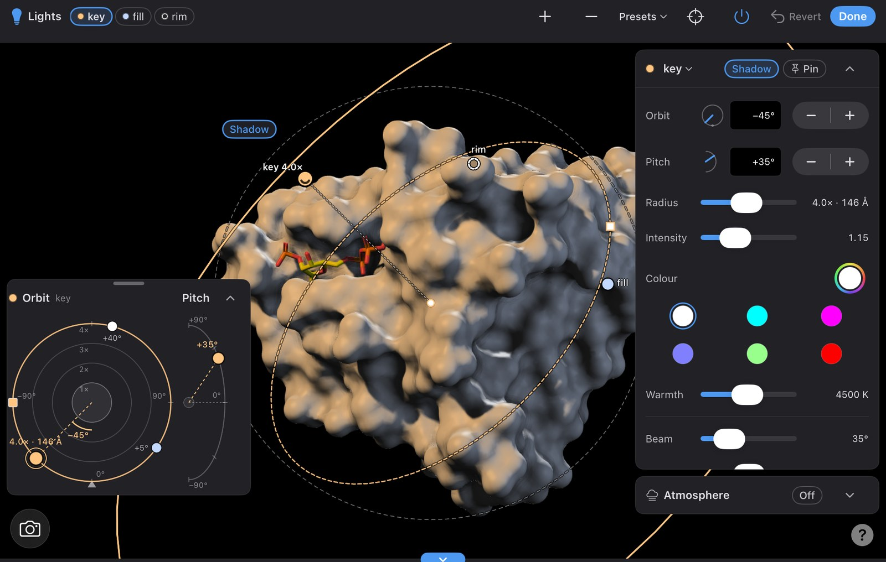
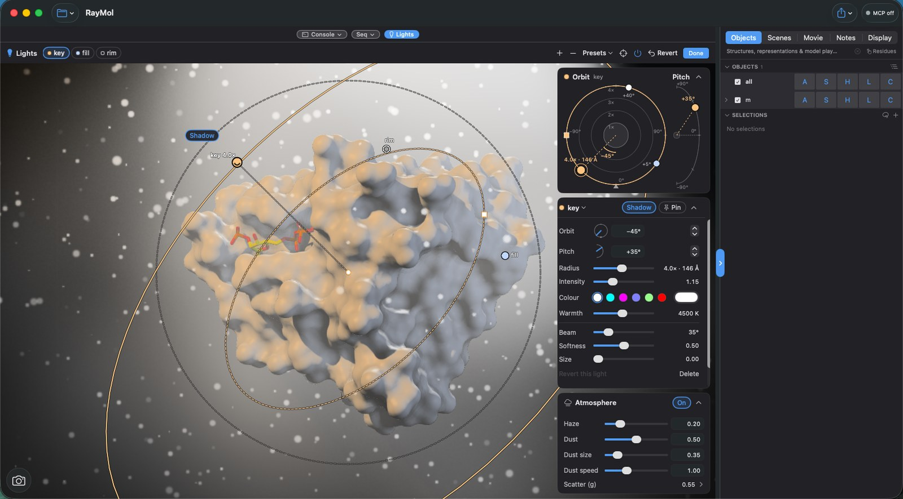
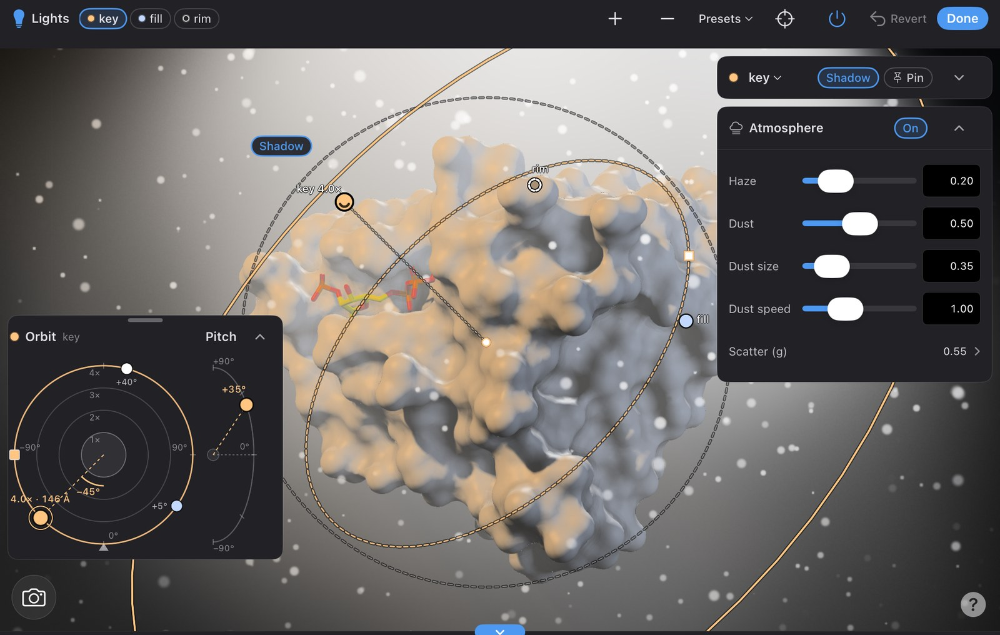

<video src="/RayMol/media/lights-hero.mp4" autoplay loop muted playsinline aria-label="A grey molecular surface of DHFR with its NADPH cofactor as yellow sticks. A warm key light circles the molecule through faint haze and drifting dust while a blue rim light outlines its edge, and the surface's shadows swing round with the light"></video>

*A warm key light orbiting DHFR (PDB 1RX1) through haze and dust, with a cool rim light.*

Studio lights give RayMol a photographer's lighting rig. Instead of PyMOL's fixed, camera-mounted shading, you place up to **six spot lights** around the molecule. Each light has its own position, beam, colour, colour temperature, brightness and **its own coloured shadow**. The lights can shine through **haze and floating dust**, which catch the beams and show the molecule's shadow as light shafts in the air.

You can build a rig three ways, and they all edit the same rig:

- **Presets:** `lights three_point` (or **Presets** in Lights mode) sets up a complete studio rig in one step.
- **Lights mode:** drag lights around the molecule in the viewport, on an orbit map and in an inspector, on Mac, iPad and iPhone.
- **Commands and Python:** `lights`, `atmosphere`, `cmd.get_lights()` and `cmd.set_lights()` script every value exactly.

Three rules hold everywhere:

- **A rig never changes your molecule.** It never touches an object's colours, materials, settings or coordinates. Lighting is applied only when the picture is drawn.
- **Turning it off gives PyMOL's lighting back exactly.** `lights off` (or the Lights switch) returns to PyMOL's own `ambient`, `direct`, `reflect` and `specular` lighting, exactly as it was. The rig is kept, so `lights on` brings it back.
- **Studio lights are drawn by RayMol's Metal renderer** on macOS, iPadOS and iOS: the live view, image exports and movie exports, with or without Metal ray tracing. The classic CPU `ray` command keeps PyMOL's own lights and says so (see [What renders studio lights](#what-renders-studio-lights)).

## Quick start

Type these into the RayMol console:

```text
lights three_point                    # a complete key / fill / rim rig
lights key, warmth=3800, intensity=1.3   # warm up and brighten the key light
lights rim, color=cyan                # tint the rim light
atmosphere haze=0.2, dust=0.4         # add haze and floating dust
lights                                # print the rig
```

Turn the rig off and on at any time:

```text
lights off
lights on
```

Or open **Lights mode** (**Tools ▸ Enter Lights Mode**, `⌃L`) and pick a preset from the **Presets** menu in the Lights bar.

<div class="media-grid">
  <figure><figcaption>PyMOL's own lighting</figcaption></figure>
  <figure><figcaption><code>lights three_point</code></figcaption></figure>
</div>

## How a rig works

### Lights and the rig

A **rig** holds up to **six spot lights**, plus the scene-wide **atmosphere** (haze and dust) and two rig values: `ambient` and `classic`. **At most three lights cast shadows.**

There is one rig per session. It is not an object, so it never appears in the object list and never changes the scene's extent. It is not a setting either. Session files (`.pse`) save it, scenes store it, `reinitialize` clears it, and `reinitialize settings` leaves it alone.

The rig is **on** when it is enabled and holds at least one light. While it is on:

- The studio lights replace PyMOL's own lights. PyMOL's `direct`, `reflect` and `specular` lights are scaled by the rig's `classic` value, which is 0 by default, so only the studio lights shine.
- The rig's `ambient` replaces the `ambient` setting.

No setting is written, so turning the rig off restores PyMOL's lighting exactly.

### Where a light sits: orbit, pitch and radius

Each light sits on a sphere around the rig's **centre** and points back at it. Three numbers place it, measured from the camera's point of view:

| | Range | Meaning |
| :--- | :--- | :--- |
| `orbit` | −180° to 180° (wraps) | Around the molecule: **0** is at the camera, **+90** camera-right, **−90** camera-left, **180** behind the molecule (a rim or back light). |
| `pitch` | −90° to 90° | Up and down: **0** is level with the camera, **+90** straight above, **−90** straight below. Measured from the camera's up, not the molecule's. |
| `radius` | 0.5 to 8 | Distance from the centre, in **scene sizes**: **1** is the edge of the molecules, **4** (the default) four times as far. |

<video src="/RayMol/media/lights-orbit.mp4" autoplay loop muted playsinline aria-label="A single warm key light circles the DHFR surface once: from the camera, to the right, behind (where only the edges are lit), to the left and back, its shadows sweeping across the surface"></video>

*`orbit` from 0 through 90, 180 and −90 back to 0: the light circles the molecule once. Behind it (180) it becomes a rim light.*

<video src="/RayMol/media/lights-pitch.mp4" autoplay loop muted playsinline aria-label="The key light moves from below the molecule to almost straight above it and back, the shadows in the grooves flipping from upward to downward"></video>

*`pitch` from −60 (below) to 85 (above) and back.*

**The frame.** The rig's centre is the middle of the box around the enabled objects, and **one scene size** is half that box's diagonal, which is roughly the edge of the molecules. RayMol captures both when you add the first light or apply a preset, and again only when you **re-centre** (`lights recenter`, or **Re-centre** in Lights mode). Zooming, panning, showing or hiding things never moves the lights. Re-centre after you load a new structure or change what is shown.

`lights` prints each light's radius in Å as well, for example `radius 4 (145.6 A)`.

### Camera lights and pinned lights

By default every light is a **camera light**: it moves with the camera. When you rotate the molecule, the lights stay where they are relative to you, so the side facing you stays lit. This is how a photographer lights a subject on a turntable.

A **pinned light** (`pin=1`, or **Pin** in the inspector) stays fixed in the scene instead. It turns with the molecule, the way the sun stays put while you walk round a statue. A pinned light is fixed in space, not attached to one object: moving one object with the Move tool does not move it.

<div class="media-grid">
  <figure><video src="/RayMol/media/lights-turn-camera.mp4" autoplay loop muted playsinline aria-label="The molecule turns a full circle; the light stays on the upper left as seen from the camera, so the visible face is always lit the same way"></video><figcaption>Camera light: the lighting stays put on screen as the molecule turns</figcaption></figure>
  <figure><video src="/RayMol/media/lights-turn-pinned.mp4" autoplay loop muted playsinline aria-label="The molecule turns a full circle with a pinned light; the lit side turns away and the molecule passes through shadow before coming back into the light"></video><figcaption>Pinned light: the light turns with the molecule</figcaption></figure>
</div>

### Where a light points: aim

A light points at the rig's centre by default (`aim=centre`). It can also aim at a point (`aim=x/y/z` in Å) or at a selection (`aim=organic`). A selection aim is resolved once: the light points where the selection's centre is at that moment and does not follow the atoms afterwards. Aim again to update it. The [placement helpers](#placing-lights-precisely) below aim and fit the beam for you.

## Presets

Seven presets set up a complete rig in one command, or from **Presets** in the Lights bar. A preset **replaces the lights** and the rig's `ambient` and `classic`. It **keeps the atmosphere**, turns the rig on and re-captures the frame. Each preset's first light casts a shadow.

<div class="media-grid cols-4">
  <figure><figcaption><code>three_point</code></figcaption></figure>
  <figure><figcaption><code>softbox</code></figcaption></figure>
  <figure><figcaption><code>spotlight</code></figcaption></figure>
  <figure><figcaption><code>rembrandt</code></figcaption></figure>
  <figure><figcaption><code>neon</code></figcaption></figure>
  <figure><figcaption><code>sunset</code></figcaption></figure>
  <figure><figcaption><code>underlight</code></figcaption></figure>
  <figure><figcaption>PyMOL's lights, for comparison</figcaption></figure>
</div>

| Preset | Lights | Ambient | Look |
| :--- | :--- | :--- | :--- |
| `three_point` | `key`, `fill`, `rim` | 0.10 | Classic portrait: a warm key light with a shadow, a cool fill and a white rim. |
| `softbox` | `left`, `right`, `top` | 0.16 | Product shot: two big soft white lights and a gentle top light. |
| `spotlight` | `spot`, `bounce` | 0.05 | Theatre: one narrow beam from above, slightly off-centre; the rest falls off. |
| `rembrandt` | `key`, `kicker` | 0.04 | Dramatic: one hard warm key high to the side, almost no fill. |
| `neon` | `magenta`, `cyan`, `front` | 0.06 | Coloured rims: magenta and cyan from behind, a dim violet front light. |
| `sunset` | `sun`, `sky` | 0.08 | A low orange sun from one side, blue sky light from the other. |
| `underlight` | `under`, `rim` | 0.04 | Horror film: a green-tinted key from below and a red rim. |

<figure><figcaption>The Presets menu in the Lights bar</figcaption></figure>

```text
lights presets             # list the presets with their descriptions
lights neon, ambient=0.1   # apply a preset with a brighter ambient
```

A preset is a starting point: change any light afterwards (`lights key, warmth=3000`) or add more. Preset colours are fixed RGB values, so `set_color` never changes a preset.

## Lights mode

Lights mode is where you light a scene by eye. Open it with **Tools ▸ Enter Lights Mode** (`⌃L`) in the menu bar on the Mac, or **Lights** in the toolbar's **Tools** menu on any device. You can also use **Open Lights tool** in the **Lighting** group of the inspector's **Display** tab (see [The Lighting group](#the-lighting-group-in-the-display-tab)). Like Move and Measure, Lights mode is an interaction mode: entering it leaves the others.


*Lights mode on the Mac: the Lights bar, the on-screen gizmo, and the orbit view, inspector and Atmosphere card beside the viewport.*

All four tools (the Lights bar, the gizmo, the orbit view and the inspector) work on the same **selected light**. Every edit shows in all of them at once, and in the `lights` command's output.

### The Lights bar

The bar floats across the top of the viewport:

- **Light menu**: shows the selected light's dot and name. The dot is the colour the light actually casts (its colour tinted by its warmth), with a thin outline so a white light still shows. A **hollow** dot means the light is currently behind the molecule. Open the menu to select another light, add or remove one, toggle **Shadow** and **Pin**, pick a **Colour**, or turn the rig on or off.
- **+ / −**: add a light (up to six) or remove the selected one. A new light casts a shadow while fewer than three lights do.
- **Presets**: apply any [preset](#presets); each entry says what the rig looks like.
- **Re-centre**: re-capture the rig's centre and size from what is shown now (`lights recenter`).
- **Atmosphere**: the fog button opens the haze and dust controls in a popover (see [The Atmosphere card](#the-atmosphere-card)). The fog is filled while the air is on, and a dot on it means a hint applies.
- **Lights switch**: turn the whole rig on or off (`lights on` / `lights off`).
- **Revert** puts back the rig you had when you entered Lights mode, atmosphere included. **Done** (or `Esc`) keeps your edits and leaves the mode. Light edits do not go on the undo stack, so **Revert** is the way back.

### The gizmo: lighting directly on the molecule

In Lights mode RayMol draws handles over the scene. They are overlays only: they never cast shadows, never appear in renders or exports, and never change the scene's extent.

- **Knobs.** Each light is a knob on a sphere around the molecule: filled when the light is in front of the molecule, hollow when it is behind. **Drag a knob** to move the light. Dragging it across the molecule's outline swaps it between front and back.
- **Radius.** **Scroll** over a knob (pinch a knob on iPad and iPhone) to move the light closer or farther.
- **Beam and softness rings.** The selected light shows two rings where its beam meets the molecule. Drag the **outer ring** to widen or narrow the beam (`beam`). Drag the **inner ring** to set how soft its edge is (`softness`).
- **Aim dot.** Drag the dot in the middle of the beam to aim the light at whatever surface is under the pointer. **Double-click** it (double-tap on iPad and iPhone) to aim back at the rig's centre.
- **Place a highlight.** **Option-click** the molecule (long-press on iPad and iPhone) to move the selected light so that it puts a specular highlight exactly where you clicked. Near the molecule's outline this places a rim light instead. The command equivalent is the `click=` [helper](#placing-lights-precisely).
- **Shadow chip.** A **Shadow** tag beside the selected knob turns that light's shadow on and off.
- **Grid mode.** With `grid_mode` on, the gizmo is drawn in the cell under the pointer (on iPad and iPhone, the cell you last touched), and a drag stays in the cell where it started.

Only the knobs, rings, the aim dot and the orbit view's handles edit lights. Every other drag, pinch or scroll still moves the camera.

<video src="/RayMol/media/lights-mac-knob-drag.mp4" autoplay loop muted playsinline aria-label="On the Mac, the key light's knob is dragged up over the molecule, across to the right, down and back. A label beside the knob shows its orbit and pitch, the lit side and shadows of the surface follow the light, and the orbit view and inspector values update as it moves"></video>

*Dragging the key light's knob on the Mac: the label shows its orbit and pitch, and the orbit view and inspector follow live.*

<div class="media-grid">
  <figure><video src="/RayMol/media/lights-iphone-pinch.mp4" autoplay loop muted playsinline aria-label="On iPhone, two fingers pinch on the key light's knob; the knob slides outward along its ray and the radius label changes, while the camera stays still"></video><figcaption>Pinch a knob to change only that light's radius (iPhone)</figcaption></figure>
  <figure><figcaption>Lights mode on iPhone in portrait</figcaption></figure>
</div>

### The orbit view

The orbit view is a flat map of the rig seen from above. The camera is at the bottom edge, +90° is to the right, and the rings mark radius in scene sizes. Beside it, an arc shows the selected light's pitch.

- **Drag a lamp** around the map to change its orbit only. Tap a lamp to select it.
- **Drag the square** on the selected light's ring, or **pinch** the map, to change its radius only, in steps of 0.5×. The beam keeps its angle.
- **Drag the handle on the pitch arc** to raise or lower the light (−90° to +90°).
- A pinned light moves around the map as you turn the molecule.

With VoiceOver or the keyboard, a lamp moves in 15° steps.

### The inspector

The inspector holds the selected light's exact values:

- **Orbit** and **Pitch**: a dial, a number field and a stepper. The stepper moves 5°; in a field, the up and down arrow keys move 1°. With the viewport focused, the arrow keys orbit (left and right) or pitch (up and down) the selected light by 1°, or 10° with `⇧`.
- Sliders for **Radius**, **Intensity**, **Warmth**, **Beam**, **Softness** and **Size** (the light's size for [soft shadows](#soft-shadows-from-large-lights)).
- **Colour**: a row of swatches and a full colour picker.
- **Shadow** and **Pin** toggles. Turning on a fourth shadow explains that at most three lights cast shadows. If the scene's **Shadows** switch is off, a hint offers **Turn On**.
- **Revert this light** and **Delete**.
- **Exposure**, a rig-wide slider under the light's rows: the same setting as **Exposure** in the Display tab's Effects, which under the rig scales the lit scene and the air (see [Exposure and HDR](#exposure-and-hdr)).


*The orbit view and the inspector on iPad.*

### The Atmosphere card

The **Atmosphere** card edits the haze and dust: **Haze**, **Dust**, **Dust size** and **Dust speed**, each a slider with a typed value, plus **Scatter (g)**, **Dust glow** and **Dust opacity** under a disclosure. Its header holds an on/off switch:

- **Off** runs `atmosphere off`, after the card remembers what you had.
- **On** puts the remembered air back, or starts from haze 0.2 and dust 0.5.

The card and the `atmosphere` command mirror each other, and **Revert** in the bar restores the air you entered with. When the air can't show, the card says why: there is no light yet, the lights are off, or strong haze with a light behind the molecule may wash the picture out (see [Backlit haze](#backlit-haze-and-exposure)).

On the Mac and iPad the card opens as a popover from the **Atmosphere** button on the Lights bar. On iPhone it is a section of the light editor, opened from the **Atmosphere** entry on the Lights bar.


*The Atmosphere card on the Mac, switched on: haze and dust glow in the key light's beam.*


*The same card on iPad.*

### On iPad and iPhone

Lights mode works with touch on every device. Every light target is at least 44 pt, and the tools are arranged by the space available:

- **Mac**: the orbit view, inspector and Atmosphere card are cards in the side column.
- **iPad**: the Lights bar has the same **light menu** and **Atmosphere** button as on the Mac. The orbit view **floats** over the viewport in a corner. Drag its header to move it to another corner, and RayMol remembers your choice. The inspector sits in the top-right corner and starts collapsed to its header. When you type into a field, the float and the inspector stay above the keyboard.
- **iPhone in portrait**: the Lights bar shows a **light menu** in place of the chips: the selected light's dot and name. The menu selects a light, adds or removes one, toggles **Shadow** and **Pin**, picks a **Colour**, turns the rig on or off, and opens the full editor with **Edit light…**. The editor is a sheet with two heights (**More** and **Less**) and a **Close** button. While it is closed, the whole molecule stays visible.
- **iPhone in landscape**: the same tools sit in the side panel.

<div class="media-grid cols-3">
  <figure><figcaption>The light menu</figcaption></figure>
  <figure><figcaption><b>Edit light…</b>: the editor sheet</figcaption></figure>
  <figure><figcaption>The Atmosphere section</figcaption></figure>
</div>

<video src="/RayMol/media/lights-iphone-menu.mp4" autoplay loop muted playsinline aria-label="On iPhone in portrait, the light menu opens, fill is selected, the menu opens again and Edit light opens the editor sheet with the fill light's controls, which is then closed" class="phone"></video>

*iPhone in portrait: pick a light from the menu, then open its editor with **Edit light…***

### The Lighting group in the Display tab

Outside Lights mode, the **Lighting** group in the inspector's **Display** tab follows the rig:

- A **Studio lights** switch turns the rig on and off from anywhere. Turning it on with no lights adds one, as **+** does in Lights mode. Turning it off keeps the rig.
- **Open Lights tool** enters Lights mode (`⌃L`).
- While the rig is on, PyMOL's **Ambient**, **Direct**, **Reflect** and **Specular** sliders stay visible but are disabled, with a note that the rig is in charge. **Material default**, **Shininess** and **Subsurface wrap** stay live, because the rig never touches them.

<figure><figcaption>The Display tab with the studio lights on</figcaption></figure>

## Shaping a light

Each light has its own fields. Set them in the inspector, or with `lights <name>, field=value, ...`:

### Beam and softness

`beam` is the full angle of the light's cone, from 1° to 170° (default 45°). Like a real spotlight, the beam keeps its angle when the light moves, so a light moved closer lights a smaller patch. `softness` (0 to 1, default 0.4) is the share of the cone that fades out at its edge: **0** is a hard-edged disc of light, **1** fades all the way from the centre.

<div class="media-grid cols-3">
  <figure><figcaption><code>beam=10</code></figcaption></figure>
  <figure><figcaption><code>beam=20</code></figcaption></figure>
  <figure><figcaption><code>beam=40</code></figcaption></figure>
  <figure><figcaption><code>softness=0</code></figcaption></figure>
  <figure><figcaption><code>softness=0.5</code></figcaption></figure>
  <figure><figcaption><code>softness=1</code></figcaption></figure>
</div>

<div class="media-grid">
  <figure><video src="/RayMol/media/lights-beam.mp4" autoplay loop muted playsinline aria-label="The beam opens from a narrow spot on the ligand to a wide pool over the left half of the molecule and closes again, its edge outlined on the surface"></video><figcaption><code>beam</code> from 6° to 34° and back, with <code>outline=1</code></figcaption></figure>
  <figure><video src="/RayMol/media/lights-softness.mp4" autoplay loop muted playsinline aria-label="A 16 degree beam's edge goes from hard to fully soft and back"></video><figcaption><code>softness</code> from 0 to 1</figcaption></figure>
</div>

`outline=1` draws the edge of the beam on the molecules, which helps when aiming. The outline is only a guide: it lights nothing and casts nothing.

### Distance and falloff

`radius` moves the light closer or farther (0.5 to 8 scene sizes). Because the beam angle stays fixed, a near light makes a small, intense pool and a far light a broad one. `falloff` (0 to 2, default 2) sets how fast light dims with distance: **2** is the physical inverse-square law, so the near side of the molecule is brighter than the far side; **0** lights everything in the beam equally.

<video src="/RayMol/media/lights-radius.mp4" autoplay loop muted playsinline aria-label="A 14 degree beam's pool of light grows as the light moves away from the molecule and shrinks as it comes back"></video>

*`radius` from 1.1 to 3.2 and back: the beam's angle stays the same, so a farther light covers more.*

<div class="media-grid">
  <figure><figcaption><code>falloff=2</code> (inverse square)</figcaption></figure>
  <figure><figcaption><code>falloff=0</code></figcaption></figure>
</div>

### Colour and warmth

Give a light a colour with `color` (any PyMOL colour name, `0xRRGGBB`, or r/g/b values) or `rgb=[r, g, b]`. `warmth` is a colour temperature in kelvin (1500 to 15000, default 6500, neutral daylight). It tints the light the way a photographer's white balance does: low values are candle and tungsten orange, high values are cool blue sky. Warmth multiplies the colour, so a coloured light can be warmed or cooled too. `color=warm`, `neutral` and `cool` set a white light at 3200 K, 6500 K and 9000 K.

<video src="/RayMol/media/lights-warmth.mp4" autoplay loop muted playsinline aria-label="The key light's colour sweeps from deep orange at 1800 K through white to pale blue at 12000 K and back"></video>

*`warmth` from 1800 K to 12000 K and back.*

<div class="media-grid cols-4">
  <figure><figcaption><code>warmth=2200</code></figcaption></figure>
  <figure><figcaption><code>warmth=4000</code></figcaption></figure>
  <figure><figcaption><code>warmth=6500</code></figcaption></figure>
  <figure><figcaption><code>warmth=12000</code></figcaption></figure>
</div>

<div class="media-grid cols-3">
  <figure><figcaption><code>color=orange</code>, sky-blue rim</figcaption></figure>
  <figure><figcaption><code>color=hotpink</code>, cyan rim</figcaption></figure>
  <figure><figcaption><code>color=palegreen</code>, violet rim</figcaption></figure>
</div>

### Intensity and highlights

`intensity` (0 to 4, default 1) is the light's brightness. Studio lights are computed in high dynamic range: a light brighter than 1 rolls off smoothly towards white **keeping its hue**, instead of clipping to flat white (see [Exposure and HDR](#exposure-and-hdr)). `highlight` (0 to 1, default 0.5) is the strength of the light's specular glint on shiny surfaces, in the light's own colour.

<div class="media-grid cols-4">
  <figure><figcaption><code>intensity=0.5</code></figcaption></figure>
  <figure><figcaption><code>intensity=1.5</code></figcaption></figure>
  <figure><figcaption><code>intensity=3.5</code> (HDR)</figcaption></figure>
  <figure><figcaption><code>intensity=3.5</code>, 8-bit knee</figcaption></figure>
</div>

## Placing lights precisely

Placement helpers do the geometry for you. They are resolved once, when you give them: the light does not follow the atoms afterwards.

- **`target=<selection>`** aims the light at the selection's centre and fits the beam to it (its radius plus 1.5 Å). The light keeps its orbit, pitch and radius. Use it to spotlight a ligand or an active site.
- **`highlight=<selection>`** moves the light so the surface at the selection's centre shows a specular highlight towards the camera. It uses the mirror direction of the surface you see there: whatever is drawn as surface, cartoon, spheres or sticks. The selection must be on screen.
- **`click=x/y`** does the same for the surface under a point of the viewport: x and y run from −1 to 1, with 0/0 at the centre and 1/1 at the top-right corner. This is what option-click and long-press do in Lights mode.
- **`rim=<degrees>`** goes with `highlight=` or `click=`. It swings the light that many degrees (0 to under 180) away from the camera, towards the side of the surface, for a rim light that outlines the edge.
- **`pin=1`** with a helper pins the light where the helper put it.

```text
lights three_point
lights key, target=organic                       # spotlight the ligand
lights add, spec, highlight=resi 124, beam=20    # a highlight on His124
lights rim, highlight=organic, rim=150           # a rim light round the ligand
lights key, pin=1                                # fix the key in the scene
```

<div class="media-grid cols-3">
  <figure><figcaption><code>target=resn NAP</code></figcaption></figure>
  <figure><figcaption><code>highlight=resi 124</code></figcaption></figure>
  <figure><figcaption><code>highlight=resi 124, rim=145</code></figcaption></figure>
</div>

`highlight=` and `click=` place the light on its current radius as a camera light. If the picked point is beyond that radius, the radius is raised with a note. The beam is fitted to a 10 Å patch around the point (never narrower than 20°) unless you give `beam=`. `click=` depends on the window's shape, so the same coordinates can pick different points in different windows.

## Shadows

Any light can cast **its own shadow**, in **its own colour**: a red light's shadow is simply where the red light doesn't reach, so another light's colour shows through it. Turn shadows on with `shadow=1`, **Shadow** in the inspector, or the **Shadow** chip beside a knob. **Up to three lights per rig cast shadows.** A light added with `lights add` or **+** casts a shadow from the start while fewer than three lights do.

<div class="media-grid cols-3">
  <figure><figcaption>No shadows</figcaption></figure>
  <figure><figcaption>Red casts a shadow</figcaption></figure>
  <figure><figcaption>Both cast shadows</figcaption></figure>
</div>

```text
lights add, red, orbit=-90, pitch=0, rgb=1/0.12/0.06, shadow=1
lights add, blue, orbit=90, pitch=0, rgb=0.15/0.35/1, shadow=1
```

- Studio shadows need the scene's **Shadows** switch on (`set metal_shadows, on`). With it off, shadowed lights render without shadows, and the inspector offers **Turn On**.
- While any studio light casts a shadow, PyMOL's own whole-scene shadow is turned off, so the molecule is never shadowed twice.
- `set metal_light_shadow_size` sets each shadow map's sharpness: 0 is the platform default (2048 on the Mac, 1024 on iPhone and iPad), or 256 to 4096 (up to 2048 on iOS).
- In grid mode, each cell is shadowed by its own objects only.

### Soft shadows from large lights

A light's `size` is the radius of the light source itself, in scene sizes (0 to 1, default 0). A size of 0 is a point light with a crisp shadow. A larger light wraps around edges and gives a **soft penumbra**, like a softbox instead of a bare bulb.

<div class="media-grid cols-3">
  <figure><figcaption><code>size=0</code></figcaption></figure>
  <figure><figcaption><code>size=0.15</code></figcaption></figure>
  <figure><figcaption><code>size=0.45</code></figcaption></figure>
</div>

*Close-ups of the same ray-traced scene: as the light grows, the shadow edges spread into soft penumbras.*

Soft shadows are **ray traced on the Mac**. They need **Metal ray tracing** on (**Ray-traced (AO + shadows)**, `set metal_raytrace, 1`), the scene's **Shadows** on, and the light's **Shadow** on. RayMol then traces shadow rays towards a disc of that size: 8 rays per light per pixel in the live view and 16 in exports, smoothed by a depth-aware denoiser. Opaque surfaces cast and receive soft shadows. Transparent surfaces and the haze keep sharp shadow maps. On iPhone and iPad, and in raster renders without ray tracing, `size` has no effect and shadows stay sharp; the iOS inspector says so.

```text
set metal_raytrace, 1
lights key, size=0.2
```

## Atmosphere: haze and dust

The **atmosphere** is the air the lights shine through: **haze** that glows where a beam passes, and **floating dust** whose motes glint inside the beams. A light that casts a shadow also shadows the haze, so the molecule throws **light shafts** through the air. The atmosphere belongs to the rig and shows only inside beams, and only while the lights are on.

```text
atmosphere haze=0.3, dust=0.5      # set the air
atmosphere seed=7                  # another dust pattern
atmosphere                         # print the air
atmosphere off                     # everything back to its default
```

Use the `atmosphere` command or the [Atmosphere card](#the-atmosphere-card) in Lights mode; they mirror each other. **Presets keep the air**, and so do `lights off` and `lights clear`: only `atmosphere off` resets it. With no rig, `atmosphere ...` creates an empty rig that is off, and the air appears once you add a light or apply a preset.

### Haze

`haze` (0 to 1) is how much haze is in the air. The haze lights up only inside the cones, so each beam becomes visible, and shadowed lights carve the molecule's shadow into it.

<div class="media-grid cols-3">
  <figure><figcaption><code>haze=0</code></figcaption></figure>
  <figure><figcaption><code>haze=0.25</code></figcaption></figure>
  <figure><figcaption><code>haze=0.6</code></figcaption></figure>
</div>

<video src="/RayMol/media/lights-haze.mp4" autoplay loop muted playsinline aria-label="Haze builds up in a narrow warm beam until the cone glows and the molecule's shadow shows as dark shafts, then clears again"></video>

*`haze` from 0 to 0.6 and back, with a little dust.*

The haze has **Beer–Lambert extinction**: it dims what lies behind it, and the light it scatters is dimmed by the haze in front, so the molecule keeps its contrast instead of disappearing into a bright fog. The empty background is never dimmed.

### Dust

`dust` (0 to 1) fills the air with floating motes that glint where they cross a beam. `dust_size` (0.05 to 2, default 0.35) sets their size relative to the scene. `dust_speed` (0 to 10, default 1) is how fast they drift: 1 is real time, 0 holds them still. `seed` picks a different random pattern.

<video src="/RayMol/media/lights-dust.mp4" autoplay loop muted playsinline aria-label="Large dust motes drift through a warm beam crossing from the left, each mote glinting while it is inside the beam"></video>

*Dust drifting through a beam from the left (`dust=1`, `dust_size=0.9`, `dust_glow=1.8`, `dust_speed=1.5`, a little haze).*

Two more controls, under the disclosure in the Atmosphere card, shape the motes:

- `dust_glow` (0 to 4, default 1) scales how brightly a mote glows in a beam. 0 hides the glints, and values above 1 make sparkling motes.
- `dust_opacity` (0 to 1, default 0) makes motes solid. At 0 they are see-through glints that only add light. Above 0, each mote also hides what is behind it, so an unlit mote shows as a faint dark speck, like real dust between you and the subject.

<div class="media-grid cols-3">
  <figure><figcaption><code>dust_glow=0.3</code></figcaption></figure>
  <figure><figcaption><code>dust_glow=1</code></figcaption></figure>
  <figure><figcaption><code>dust_glow=3</code></figcaption></figure>
  <figure><figcaption><code>dust_opacity=0</code></figcaption></figure>
  <figure><figcaption><code>dust_opacity=0.5</code></figcaption></figure>
  <figure><figcaption><code>dust_opacity=1</code></figcaption></figure>
</div>

### Scattering

`scatter` (−0.9 to 0.9, default 0.55) is the haze's forward scattering. Real haze scatters most light onward, so a beam pointing towards the camera glows brightest. That is why backlit haze looks dramatic. Positive values make a back light's glow stronger, 0 scatters evenly in all directions, and negative values send light back towards the lamp.

<div class="media-grid cols-3">
  <figure><figcaption><code>scatter=-0.5</code></figcaption></figure>
  <figure><figcaption><code>scatter=0</code></figcaption></figure>
  <figure><figcaption><code>scatter=0.8</code></figcaption></figure>
</div>

### Backlit haze and exposure

Strong haze (above about 0.3) with a light behind the molecule can wash the picture out: you are looking straight into the forward-scattered glow. The Atmosphere card warns you when this applies. Lower the haze, move the light, or lower the **exposure**. Under studio lights, exposure scales the lit scene and the air together, so the molecule keeps its colour and contrast:

```text
set metal_exposure, 0.5
```

<div class="media-grid">
  <figure><figcaption>Backlit haze, <code>metal_exposure 1</code></figcaption></figure>
  <figure><figcaption><code>metal_exposure 0.4</code></figcaption></figure>
</div>


*Two coloured, shadowed beams crossing in haze and dust.*

### Dust in renders and movies

- **Live view.** The dust drifts at up to 30 frames a second while RayMol is active and its window is visible. In Low Power Mode, or when the device is hot, the dust holds still. Haze alone never moves.
- **Movies.** Movie export and playback drive the dust from the movie's own clock, so every export of a movie is identical. A change of `dust_speed` between scenes keeps the dust moving smoothly.
- **Repeatable stills.** Pin the dust clock to a fixed time for figures you need to reproduce exactly: `set metal_light_air_time, 2`. Set it back to −1 to let the dust drift.
- **Transparent backgrounds.** A transparent PNG export (`ray_opaque_background 0`) cuts the haze and dust out over the empty background by default. `set metal_light_air_alpha, 1` keeps them.

## Exposure and HDR

Under a studio rig, RayMol computes light in high dynamic range. Light is kept in scene units, where a bright rig goes above 1. It is multiplied by `metal_exposure`, then mapped once through a **hue-preserving tone curve**. A bright light therefore rolls off towards white keeping its hue instead of flattening to white early, and a light up to `intensity=4` stays readable.

- **Exposure** (`metal_exposure`, **Exposure** in the Display tab's Effects, or the **Exposure** row in the Lights inspector) scales what the rig lights and the air. Under a rig it leaves the background colour, labels and outlines alone.
- **Filmic tone-map** (`metal_tonemap`, in the Display tab's Effects) swaps the rig's curve for **ACES**. ACES is applied in scene units on the brightest channel, so saturated highlights keep their hue instead of going pastel.
- **The 8-bit knee.** `set metal_light_hdr, 2` gives the earlier 8-bit soft knee instead of HDR; `0` returns to the default (HDR).

Without a rig, or with the rig off, exposure and ACES work on the whole frame as they always have.

<div class="media-grid cols-3">
  <figure><figcaption><code>metal_exposure 0.5</code></figcaption></figure>
  <figure><figcaption><code>metal_exposure 1</code></figcaption></figure>
  <figure><figcaption><code>metal_exposure 2</code></figcaption></figure>
</div>

## Scenes, sessions and movies

- **Sessions.** `.pse` files save the rig and its atmosphere. Older RayMol builds ignore it and open the file with PyMOL's own lighting.
- **Scenes.** Each stored scene (`scene <name>, store`, or the inspector's **Scenes** tab) captures its own rig and atmosphere, and recalling it restores them. A scene stored with the rig off turns the rig off when you recall it.
- **Movies.** A scene movie **blends the lights** between scenes, with the camera's easing. Lights are matched by name. Orbit, pitch, radius, beam, softness, intensity, warmth, highlight, falloff, `ambient`, `classic` and the atmosphere all blend. Angles take the shortest way round and colours blend smoothly. A light that exists in only one of the two scenes fades in or out. Shadow, outline, anchor, aim and the rig's on/off switch change at the cut.

<video src="/RayMol/media/lights-rigs.mp4" autoplay loop muted playsinline aria-label="A scene movie on the DHFR surface blending smoothly from the three_point preset to neon, then sunset, then rembrandt and back to three_point, the lights' colours and directions flowing from one rig to the next"></video>

*A scene movie through `three_point`, `neon`, `sunset` and `rembrandt`: the lights blend between scenes.*

```text
lights three_point
scene warm, store
lights neon
scene cool, store
scene warm          # recall: the three_point rig comes back
```

## Commands and Python

### The `lights` command

```text
lights                                  print the rig
lights presets                          list the presets
lights <preset> [, ambient=a] [, classic=c]
lights add [, name] [, field=value ...]  add a light
lights <name>                           print one light
lights <name>, field=value [, ...]      change a light
lights remove, <name>                   remove a light
lights on | off | clear | recenter
lights ambient=a [, classic=c]          change the rig
```

Separate arguments with commas, as in every PyMOL command. Keywords, presets and light names ignore case.

- `lights add` without a name takes the first unused of `key`, `fill`, `rim`, `light4`, `light5`, `light6`. The first light captures the frame and turns the rig on.
- `lights remove, <name>` removes one light; removing the last turns the rig off.
- `lights clear` removes every light but keeps the atmosphere, `ambient` and `classic`.
- `lights off` turns the rig off and keeps it; `lights on` turns it back on.

Every error names the field and the allowed range, and changes nothing:

```text
PyMOL>lights key, pitch=100
 Error: lights: key: pitch=100 is out of range -90 to 90 (degrees)
PyMOL>lights rim, shadow=1
 Error: lights: rim: shadow=1: at most 3 lights cast shadows (key, spot, back already do)
```

### Light fields

| Field | Alias | Range | Default | What it does |
| :--- | :--- | :--- | :--- | :--- |
| `orbit` | `az` | −180 to 180° (wraps) | `0` | Around the centre: 0 at the camera, 90 camera-right, 180 behind. |
| `pitch` | `el` | −90 to 90° | `30` | Up and down: 0 level with the camera, 90 above. |
| `radius` | `dist` | 0.5 to 8 | `4` | Distance from the centre in scene sizes (1 is the edge of the molecules). |
| `beam` | | 1 to 170° | `45` | The cone's full angle; fixed when the radius changes. |
| `softness` | `soft` | 0 to 1 | `0.4` | The share of the cone that fades out at its edge. |
| `color` | `colour` | colour | `white` | A PyMOL colour name, `0xRRGGBB` or r/g/b; `warm`, `neutral`, `cool` set white at 3200, 6500, 9000 K. |
| `rgb` | | 0 to 1 (or 0 to 255) | | Sets `color` from r/g/b or `[r, g, b]`. |
| `warmth` | `kelvin` | 1500 to 15000 K | `6500` | Colour temperature; multiplies `color`. Lower is warmer. |
| `intensity` | `int` | 0 to 4 | `1` | Brightness; rolls off towards white under HDR. |
| `highlight` | `spec` | 0 to 1 | `0.5` | Strength of the light's coloured specular glint. |
| `falloff` | | 0 to 2 | `2` | Dimming with distance: 2 inverse square, 0 none. |
| `shadow` | | 0 or 1 | `0`* | Casts the light's own shadow (at most 3 lights). |
| `size` | | 0 to 1 | `0` | Light source radius in scene sizes: soft shadows in Mac ray-traced renders. |
| `outline` | `cue` | 0 or 1 | `0` | Draws the beam's edge on the molecules. |
| `aim` | | `centre`, `x/y/z`, selection | `centre` | Where the light points (a selection is resolved once). |
| `anchor` | | `camera`, `pinned` | `camera` | Follows the camera or stays fixed in the scene. |
| `pin` | | 0 or 1 | | `pin=1` pins the light where it is; `pin=0` makes it a camera light again. |
| `position` | | `x/y/z` in Å | | Pins the light at that point. |
| `name` | | letters, digits, `_` | | Renames the light. |

\* A light added with `lights add` or **+** starts with `shadow=1` while fewer than three lights cast shadows; `shadow=0` on `lights add` wins.

Fields that set the same thing can't be combined: `color` with `rgb`, `color=warm/neutral/cool` with `warmth`, `pin` with `anchor`, and `position` with `orbit`, `pitch`, `radius` or `pin=0`.

### Rig fields

| Field | Range | Default | What it does |
| :--- | :--- | :--- | :--- |
| `ambient` | 0 to 1 | `0.05` | Replaces the `ambient` setting while the rig is on. |
| `classic` | 0 to 1 | `0` | Scales PyMOL's own direct, reflect and specular lights while the rig is on. Raise it to mix PyMOL's camera light in with the studio lights. |

### The `atmosphere` command

```text
atmosphere                            print the air
atmosphere field=value [, ...]        change the air
atmosphere off                        every field back to its default
```

| Field | Range | Default | What it does |
| :--- | :--- | :--- | :--- |
| `haze` | 0 to 1 | `0` | Amount of haze in the air. |
| `dust` | 0 to 1 | `0` | Amount of floating dust. |
| `dust_size` | 0.05 to 2 | `0.35` | Mote size, relative to the scene. |
| `dust_speed` | 0 to 10 | `1` | Drift speed: 1 real time, 0 still. |
| `dust_glow` | 0 to 4 | `1` | How brightly a mote glows in a beam; 0 hides the glints. |
| `dust_opacity` | 0 to 1 | `0` | How solid a mote is: 0 see-through glints, above 0 motes hide what is behind them. |
| `scatter` | −0.9 to 0.9 | `0.55` | Forward scattering: above 0, beams glow more when pointing towards the camera. |
| `seed` | 0 to 1000000 | `0` | The dust pattern. |

### Python

`cmd.lights()` and `cmd.atmosphere()` take the same arguments as the commands, with Python numbers, booleans and lists as values. `cmd.get_lights()` returns the whole rig as a dictionary (or `None` with no rig), and `cmd.set_lights(rig)` replaces the rig from one, so you can save, edit and reapply rigs in scripts:

```python
from pymol import cmd

cmd.lights("three_point")
cmd.lights("key", orbit=-30, intensity=1.4, shadow=True)
name = cmd.lights("add", pitch=-40, color=[0.6, 0.8, 1.0], intensity=0.5)

rig = cmd.get_lights()               # a versioned dict: lights, air, ambient, ...
rig["lights"][0]["warmth"] = 3800
cmd.set_lights(rig)                  # apply the edited rig

cmd.atmosphere(haze=0.2, dust=0.3, dust_glow=1.5)
```

`cmd.lights()` with no arguments returns the rig as `cmd.get_lights()` does, `cmd.lights("<name>")` returns that light's dictionary, and `cmd.lights("add", ...)` returns the new light's name. A bad value raises `CmdException` naming the key, and the rig is left unchanged.

### Settings

These settings tune how the rig renders. They are not part of a scene's look, so scenes don't store them.

| Setting | Default | What it does |
| :--- | :--- | :--- |
| `metal_shadows` | `on` | The scene's **Shadows** switch; studio shadows need it on. |
| `metal_exposure` | `1` | Exposure. Under a rig with HDR it scales the lit scene and the air. |
| `metal_tonemap` | `off` | Filmic (ACES) tone curve; under a rig with HDR it becomes the rig's curve. |
| `metal_light_hdr` | `0` | `0` platform default (HDR), `1` HDR, `2` the 8-bit soft knee. |
| `metal_light_shadow_size` | `0` | Shadow map size per light: `0` platform default (2048 Mac, 1024 iOS), or 256 to 4096 (2048 on iOS). |
| `metal_light_air_resolution` | `0` | Atmosphere pass resolution: `0` platform default (half), `1` full, `2` half. |
| `metal_light_air_shadow_filter` | `0` | Haze shadow lookup: `0` default (one tap), `1` one tap, `2` 3×3 filter. |
| `metal_light_air_time` | `-1` | Below 0 the dust drifts; 0 or more pins the dust clock to that many seconds. |
| `metal_light_air_alpha` | `0` | `1` keeps haze and dust in transparent PNG exports. |
| `metal_gpu_timing` | `0` | Logs GPU frame times: `1` a summary each second, `2` every frame. |

## What renders studio lights

Studio lights and the atmosphere are drawn by RayMol's **Metal renderer**:

- The live viewport on Mac, iPad and iPhone.
- **Save Image**, **Copy Image** and `png` typed in the app's console, including **Ray-traced (AO + shadows)** exports with Metal ray tracing.
- **Export Movie** and `movie_export`.
- The MCP `capture_viewport` tool, so AI assistants see the lit scene.

The classic CPU ray tracer (`ray`, `png ..., ray=1`, and command-line PyMOL with no Metal view) keeps PyMOL's own lights. While the rig is on, it prints one notice per command:

```text
 Ray: studio lights are Metal-only; this ray-traced image uses PyMOL's lights.
```

`feedback disable, ray, warnings` silences the notice. Geometry exports (`.obj`, `.gltf`, `.pov`, `.wrl`, `.dae`, `.idtf`) never carry the rig.

## Performance

Studio lights are designed to run at 60 frames a second on a recent iPhone or iPad with three shadowed lights and dust. If a scene runs slowly, in rough order of effect:

1. Cast fewer shadows (each shadowed light renders its own shadow map).
2. Use smaller shadow maps: `set metal_light_shadow_size, 1024`.
3. Keep the atmosphere at half resolution (`set metal_light_air_resolution, 2`, the default) and the one-tap haze shadow (`set metal_light_air_shadow_filter, 1`).
4. Leave `size` at 0 on lights that don't need soft shadows; size 0 costs nothing.
5. `set metal_light_hdr, 2` uses the cheaper 8-bit knee.

`set metal_gpu_timing, 1` logs the GPU time per frame (to Console on the Mac, to the Xcode console on iOS), with the number and size of the shadow maps drawn.

## Known limitations

- Bezier tube cartoons neither cast nor receive studio shadows.
- Studio lights light a material's plain base colour, not its procedural pattern (for example marble veins).
- Soft shadows (`size`) are ray traced on the Mac only; iPhone, iPad and raster renders keep sharp shadows.
- The loop back from a looping movie's last scene to its first does not blend the lights.
- In Lights mode, the gizmo's rings can sit off-screen or under the bars when a light is very close, and a plain click still picks atoms.
- The dust pattern (`seed`) can only be set with the `atmosphere` command.

See also: [Materials & Looks](/RayMol/guides/materials/) (how each material responds to studio lights), [Rendering & Export](/RayMol/guides/rendering-export/), [Movies & Scenes](/RayMol/guides/movies/) and [RayMol Settings](/RayMol/reference/settings/).
