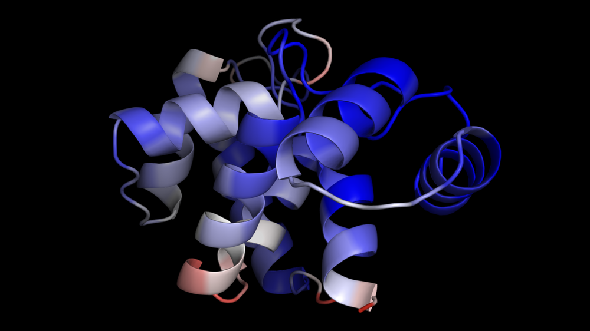

Object Metrics keeps the numerical outputs a tool measured directly beside the structure it measured them on. A structure prediction reports per-residue confidence (pLDDT), predicted aligned error (PAE), interface scores, and execution runtime, while a sequence design pass reports native fit and sequence certainty per residue.

All measurements stay attached to the molecular object, persist inside saved `.pse` session files, and can be inspected, recolored, queried via Python or PyMOL commands, and exported to JSON or CSV long after a calculation completes.

## Key concepts

### Metrics travel with the object

In traditional PyMOL workflows, per-residue numerical data is frequently stuffed into the B-factor column or written to transient atom properties (`p.*`). Both approaches lose crucial context:

- **The B-factor column is a view, not storage:** It holds a single scalar per atom. Coloring by a second measurement or running `spectrum count` overwrites whatever was there. In RayMol, metrics are stored in a dedicated run store attached to the object, and the B-factor column is merely a temporary display surface used when coloring.
- **Atom properties lack provenance:** While atom properties can hold per-atom tags, they do not track execution runs, timestamps, units, or tool options. Furthermore, atom properties cannot represent state-level scalars (such as inference runtime or mean PAE) or pairwise matrices (such as PAE), and they do not survive a `.pse` session save.
- **Multiple runs coexist:** An object can hold many runs simultaneously. Folding a sequence with [Structure Prediction](/RayMol/guides/predict/), refolding it with a deeper multiple sequence alignment, and evaluating it with [Sequence Design](/RayMol/guides/design/) produces three separate runs. None overwrites another.

### Measurement scopes

Every metric is recorded under a declared scope that defines what entity it describes:

| Scope | Entity described | Examples |
| :--- | :--- | :--- |
| `object` | The object as a whole (identical across models/states) | `n_residues`, `n_chains` |
| `state` | A specific model or coordinate set | `mean_plddt`, `elapsed_s`, `peak_bytes`, `mean_pae`, `min_ipsae` |
| `chain` | A specific chain (optionally within a state) | `msa_depth` |
| `residue` | An array indexed by `(chain, resi)` | `plddt` (prediction confidence), `native_fit`, `certainty` |
| `pair` | A pairwise matrix indexed by `(chain, resi) × (chain, resi)` | `pae` (predicted aligned error) |

This hierarchy ensures multi-model predictions (`n_models > 1`) and complex multimers are represented accurately without flattening or ambiguous averaging.

## Tools that produce metrics

Several built-in RayMol tools register and record metrics:

### Structure prediction

Running [Structure Prediction](/RayMol/guides/predict/) with Boltz-2 (`boltz2`, `boltz2-bf16`) produces:
- **Confidence scores:** `plddt` (per-residue predicted lDDT, 0–100), `mean_plddt` (state-level mean confidence), `pae` (pairwise predicted aligned error matrix, 0–32 Å), and `mean_pae` (mean off-diagonal PAE).
- **Interface assessment:** For multi-chain complexes, predictors report `min_ipsae` (minimum interface predicted TM-score / ipSAE across both directions; the primary gate metric for interfaces), `ipsae` (maximum ipSAE), and `ipae` (mean inter-chain PAE, where values below 10 Å typically mark confident interfaces). Single-chain predictions omit interface metrics.
- **Runtime and provenance:** `elapsed_s` (inference runtime), `peak_bytes` (peak memory usage), `n_residues`, `n_chains`, and `msa_depth` (per-chain sequence alignment depth).

Protenix does not write to the metric store yet; its pLDDT arrives in the B-factor column only.

### Sequence design

Opening [Sequence Design](/RayMol/guides/design/) with ProteinMPNN evaluates the backbone and records:
- `native_fit`: Log-probability assigned by ProteinMPNN to the amino acid present in the input structure, scored leave-one-out against the backbone (expected range: -6.0 to 0.0 log P; higher is better).
- `certainty`: Sequence certainty based on Shannon entropy over the amino acid distribution ($1 - H / \ln 21$, where 0 is flat and 1 is one-hot).

## Viewing metrics in the user interface

Metrics are integrated directly into RayMol's interactive workflow:

- **Live coloring in Design mode:** When entering Design mode, residues are colored in real time by ProteinMPNN fit or certainty. Hovering over a residue displays its propensity scores.
- **Structure Prediction visual feedback:** When a prediction completes, per-residue confidence is automatically mapped onto the generated structure.
- **Coloring commands:** You can project any stored per-residue metric back onto the 3D structure using the `metrics_color` command.

:::tip[Coloring non-destructive views]
Applying `metrics_color` does not alter the underlying metric records. You can cycle between prediction confidence, design scores, and standard PyMOL color schemes as often as needed.
:::

## Command reference

RayMol provides a suite of commands for interacting with the metric store from the console or scripts. For general command syntax, see the [PyMOL Commands & API reference](/RayMol/reference/commands/).

### `metrics_list`

Lists all measurement runs recorded in the current session.

```text
metrics_list [object [, tool]]
```

- `object` *(optional)*: Filter runs recorded against a specific object.
- `tool` *(optional)*: Filter by tool identifier (for example, `boltz2` or `mpnn`).

Example output:

```text
PyMOL> metrics_list pred
 boltz2_1877b875   boltz2   pred/1   n_residues=117, msa_depth/A=1000, elapsed_s=14.1
 boltz2_6a86f4b4   boltz2   pred/2   n_residues=117, msa_depth/A=1000, elapsed_s=14.2
```

The third column indicates the target `object/state`.

### `metrics_get`

Retrieves summary scalars or specific arrays from a recorded run.

```text
metrics_get [run [, key [, object [, state [, tool]]]]]
```

- `run`: Run identifier (from `metrics_list`). If omitted, RayMol targets the newest run on `object` containing `key`.
- `key`: Specific metric name (for example, `mean_plddt` or `plddt`). If omitted, all scalars and arrays in the run are listed.
- `object`: Target object name (used if `run` is omitted).
- `state`: narrow to one model. Default `0` means every state; when an object
  carries several measured states you must name one (or a `run=`), because RayMol
  refuses to pick for you.
- `tool`: Disambiguates which tool's measurement to query if multiple tools have evaluated the object.

Examples:

```text
# Print all summary scalars for an object's latest run
metrics_get pred

# Get a single scalar value for state 2
metrics_get pred, mean_plddt, state=2

# Inspect a residue-level array
metrics_get pred, plddt, state=1
```

:::caution[Disambiguation across models and tools]
If an object contains multiple states (such as an ensemble from `n_models=5`), querying a state-level scalar without specifying `state=` or `run=` raises an error. RayMol refuses to arbitrarily return the newest model's score to prevent misreporting ensemble metrics. Similarly, if multiple tools (such as `boltz2` and `mpnn`) have scored the same key, you must specify `tool=` or `run=`.
:::

### `metrics_color`

Colors a molecular object using a stored residue-level metric array.


*A Boltz-2 prediction colored by pLDDT with `metrics_color`.*

```text
metrics_color key [, object [, run [, state [, palette [, minimum [, maximum [, selection [, tool]]]]]]]]
```

- `key`: Residue-scope metric to display (e.g., `plddt`, `native_fit`, or `certainty`).
- `object`: Object to recolor.
- `run` *(optional)*: Specific run identifier.
- `state` *(optional)*: Model/state number.
- `palette` *(optional)*: Any valid PyMOL palette (defaults to `blue_white_red`).
- `minimum`, `maximum` *(optional)*: Spectrum numerical range. By default, RayMol uses the predefined expected domain for that metric (e.g., `[0, 100]` for `plddt`, `[-6.0, 0.0]` for `native_fit`), ensuring two different structures or runs color on an identical absolute scale.
- `selection` *(optional)*: Restrict recoloring to an atom selection (see [Selecting atoms and residues](/RayMol/guides/selecting/)).
- `tool` *(optional)*: Disambiguate between tools if multiple have measured `key`.

Examples:

```text
# Color by prediction confidence using default [0, 100] scaling
metrics_color plddt, pred

# Color a specific model
metrics_color plddt, pred, state=2

# Color by ProteinMPNN native fit score
metrics_color native_fit, my_design
```

Only residues actually measured by the tool are recolored; unmeasured residues retain their previous color.

### `metrics_schema`

Displays the declared schema for all tools or a specific tool, including metric keys, scopes, units, descriptions, and expected ranges.

```text
metrics_schema [tool]
```

Example:

```text
PyMOL> metrics_schema boltz2
 boltz2
   n_residues         object   residues Residues folded
   n_chains           object   chains   Chains
   msa_depth          chain    sequences Alignment depth used
   elapsed_s          state    s        Inference time
   peak_bytes         state    B        Peak memory
   plddt              residue  pLDDT    Per-residue confidence  [0..100]
   mean_plddt         state    pLDDT    Mean confidence  [0..100]
   pae                pair     A        Predicted aligned error  [0..32]
   mean_pae           state    A        Mean predicted aligned error  [0..32]
   min_ipsae          state    -        min ipSAE  [0..1]
   ipsae              state    -        ipSAE  [0..1]
   ipae               state    A        Interface PAE  [0..32]
```

### `metrics_export` and `metrics_load`

Export recorded metrics to disk or import metrics generated from external pipelines.

```text
# Export to CSV (scalars and residue arrays in long tabular format)
metrics_export scores.csv, pred

# Export to JSON (full document including 2D PAE matrices)
metrics_export scores.json, pred

# Load metrics from an external pipeline JSON document
metrics_load from_pipeline.json, pred
```

:::note[CSV exports and pairwise matrices]
CSV export omits pairwise metrics like PAE. Because an $N \times N$ matrix for a 900-residue structure expands to 810,000 rows, pairwise matrices must be exported using JSON format.
:::

### `metrics_delete`

Removes metrics from the session.

```text
metrics_delete name
```

- `name`: Can be a specific run ID, an object name (deletes all runs recorded on that object), or `"all"` (clears the entire metric store).

## Accessing metrics via Python

In addition to PyMOL commands, RayMol exposes the metric store directly to
embedded Python scripts, and to the Claude MCP server through its `run_python` tool.

### Using `pymol.cmd`

The `cmd.metrics_get` function returns parsed Python dictionaries:

```python
from pymol import cmd

# Fetch a scalar metric
mean_conf = cmd.metrics_get(object="pred", key="mean_plddt", state=1)
print(f"Mean pLDDT: {mean_conf['value']:.2f}")

# Fetch a residue-level array
plddt_data = cmd.metrics_get(object="pred", key="plddt", state=1)
# plddt_data['index'] contains [["A", "1"], ["A", "2"], ...]
# plddt_data['values'] contains [92.4, 88.1, ...]
```

### Using `pymol.metrics.store`

For advanced analysis, import the underlying `store` module:

```python
from pymol.metrics import store

# Retrieve all runs for an object
runs = store.runs(object="pred")

for run in runs:
    print(f"Run {run.id} ({run.tool}):")
    print("  Inputs:", run.inputs)
    print("  Scalars:", run.scalars())

# Extract residue mappings as dictionaries
run = runs[0]
plddt_entry = run.one("plddt", state=1)
residue_map = plddt_entry.as_map()
# residue_map is {('A', '1'): 92.4, ('A', '2'): 88.1, ...}

# Compare models in an ensemble to find the highest-confidence prediction
best_run = max(runs, key=lambda r: r.one("mean_plddt", state=r.states[0]).value)
best_model_state = best_run.states[0]
seed = best_run.inputs.get("seed")
print(f"Best model: state {best_model_state} (seed {seed})")
```

Pairwise matrices can be reshaped into NumPy arrays using the index length:

```python
import numpy as np
from pymol.metrics import store

run = store.runs(object="pred")[0]
pae_entry = run.one("pae", state=1)
n_res = len(pae_entry.index)
pae_matrix = np.array(pae_entry.values).reshape(n_res, n_res)
```

## Session persistence and lifecycle

Metrics integrate seamlessly with RayMol's session management:

- **Saved sessions (`.pse`):** All recorded runs, schemas, input parameters, and arrays are embedded inside `.pse` session files. When opened in RayMol, all metrics restore completely. When opened in upstream PyMOL, the session loads cleanly while silently ignoring the custom metrics block.
- **Session reset:** Opening a new session or running `reinitialize` empties the metric store to ensure old measurements do not linger on unrelated objects.
- **Object modifications:**
  - **Renaming:** Renaming an object with `set_name` moves all its recorded metrics to the new name.
  - **Deleting:** Deleting an object removes its associated runs from the store.
  - **Duplication (`create`):** Creating a new object from a selection does *not* copy metrics, because selections may represent arbitrary subsets where residue indices no longer align.
- **Staleness detection:** Metric states are positional. If the number of states or coordinates in an object changes after a metric was recorded, the run is flagged as `stale` in `metrics_list` and `metrics_get` output to warn that the measurement may no longer correspond to the current structure.
