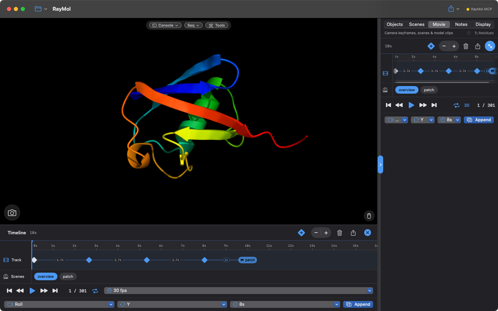

RayMol features a dedicated timeline movie studio and an expanded scene system.
You can capture camera keyframes, interpolate between complex visual states,
play back multi-state NMR and molecular dynamics trajectories, and export
publication-quality animations directly on macOS, iPadOS, and iPhone.

## Scenes in RayMol

A PyMOL scene is a comprehensive visual snapshot. While classic PyMOL scenes
only captured camera position, atom colors, and representations, RayMol extends
scenes to capture the complete rendering and physical environment.

### What a scene stores

When you store a scene in RayMol, it captures:

- **Camera & view**: Focal length (lens), magnification (zoom), orientation,
  clipping planes, and perspective versus orthographic projection.
- **Molecular representations & styles**: Visible representations (cartoon,
  sticks, spheres, surface), per-atom colors, and transparency overrides.
- **Render "look" settings**: Real-time ray tracing, ambient occlusion, shadows,
  outlines and contour widths, depth cueing (fog), tonemapping, and exposure.
- **Materials and transparency settings**: The default scene material,
  per-object and per-representation materials (`cartoon_material`,
  `surface_material`, `stick_material`, `sphere_material`), and transparency
  settings (`transparency_peel`).
- **Object placement (Move mode)**: 3D position and orientation transforms
  applied to individual objects via Move mode (`⌃M`).
- **Autofocus target**: The active `dof_focus` selection used by depth of field
  autofocus.
- **Studio lights & atmosphere** (beta): The complete studio lighting rig (up to six
  spot lights, custom colors, warmths, beams, and shadows) and atmospheric
  haze and dust parameters.

When you recall a scene, RayMol restores every setting and object placement
without altering uncaptured aspects of your session.

### Manage scenes

Open the **Scenes** tab in the inspector:

- **Store a scene**: Select the **`+`** chip to snapshot the current state into
  a new scene.
- **Recall a scene**: Select any scene chip to immediately apply its view,
  representations, materials, and lighting rig.
- **Update**: Select **Update** to overwrite the active scene with your current
  viewport settings and camera position.
- **Reorder**: Drag and drop scene chips to change their presentation sequence.
- **Step through scenes**: Use **Prev** and **Next** to step through scenes in
  order.
- **In-viewport scene buttons**: Turn on **Show scene buttons in viewport** to
  pin glanceable, one-tap scene buttons directly over the 3D viewport.

### PyMOL scene commands

You can also manage scenes from the command line:

```text
# Store a new scene named 'pocket'
scene pocket, store

# Recall a scene
scene pocket, recall

# Update the active scene
scene auto, update

# Move to next or previous scene
scene auto, next
scene auto, previous

# Delete a scene
scene pocket, delete
```

## The Timeline Movie Studio

RayMol's docked **Timeline** transforms PyMOL's frame transport into a visual
composition editor:


*The Timeline movie studio: a Roll camera clip followed by a scene clip, with the Movie tab in the Inspector.*

- **macOS & iPad**: Open the **Movie** tab in the inspector. Select the
  expand button to dock the full-width timeline below the 3D viewport (on iPad,
  this button works only in landscape orientation). On macOS, you can also choose
  **Movie ▸ Edit Timeline** (⌥⌘M) to open it.
- **iPhone**: The **Movie** tab is the timeline, formatted to fit compact screens.

### Unified timeline tracks

The timeline displays a fixed-scale time ruler (defaulting to 10 seconds across
the screen) with a horizontal track hosting three types of items:

1. **Camera keyframes (◆)**: Diamond markers holding the exact camera view.
2. **Scene markers**: Labeled capsules holding complete scene snapshots.
3. **Play-models clips**: Rectangular blocks representing multi-state coordinate
   playback across NMR ensembles or MD simulations.

### Timeline navigation and controls

- **Scrub & Seek**: Drag the playhead across the ruler or tap any point on the
  ruler to seek directly to that frame.
- **Zoom the ruler**: Use the **`+`** and **`-`** zoom buttons on the header to
  scale the time ruler.
- **Add camera keyframe**: Tap **`+◆`** on the timeline header to capture the
  current camera view as a new keyframe at the end of the track.
- **Reorder items**: Drag an item horizontally past its neighbors to reorder it;
  timing ripples automatically across the movie.
- **Item menu**: Right-click or long-press any keyframe or scene marker to seek
  to it, preview it, or delete it from the movie.
- **Transitions**: The labeled connectors between items control transition
  durations (`0.5s`, `1s`, `2s`, `5s`, `8s`) and easing (**Smooth** versus
  **Linear**). Total movie length is the sum of all transition durations.

## Motion Presets (Make Movie)

For rapid animation without manually keyframing, open **Make Movie** from the
playback bar (**Make**, or **Make Movie…** in its menu; note that the playback
bar is disabled while the timeline is empty). **Build & Play** replaces the
current movie. To add a motion to the end of the timeline instead, pick it in
the preset row at the bottom of the **Movie** tab and select **Append**.

### Camera motions

In **Make Movie**, you can choose from three camera motions:

- **Roll**: A continuous 360° spin around the selected camera axis (**X**,
  **Y**, or **Z**).
  :::note
  Roll spins at a constant, linear speed matching desktop PyMOL, avoiding
  acceleration pauses every third of a turn.
  :::
- **Rock**: An oscillating back-and-forth swing through a configurable angle
  (such as 30°, 60°, 90°, or 120°) with natural easing at the turnaround points.
- **Nutate**: A cone-shaped wobbling motion that reveals 3D contours from
  multiple angles without fully tumbling the model.

Configure duration (`4 s`, `8 s`, `16 s`, `32 s`), rotation axis, and whether
to create a **Seamless loop**, then select **Build & Play**.

By contrast, the preset row at the bottom of the **Movie** tab offers Camera
Roll and Camera Rock with **Append** to add motions onto an existing timeline
(it does not offer Nutate, 120° angles, or Seamless loop).

### Multi-state ensembles (NMR & MD)

When you load a structure containing multiple coordinate states (such as an NMR
ensemble or an imported MD trajectory), you can animate through the models
independently of camera motion using two different tools:

#### Make Movie ▸ States

Open **Make Movie** from the playback bar and select the **States** tab.
Selecting **Build & Play** creates a movie that replaces the current movie:

- **Loop**: Plays forward from the start model to the end model (`1 → N`) and
  restarts from model 1.
- **Sweep**: Plays forward and then in reverse (`1 → N → 1`) for an oscillating
  motion.

Options include a speed multiplier (`1×`, `½×`, `⅓×`, `¼×`, `⅛×`, `1⁄16×`), a
pause duration at endpoints, and a **Seamless loop** toggle.

#### Play models preset (Movie tab)

In the preset row at the bottom of the **Movie** tab, configure the **Play
models** item and select **Append** to add a model playback clip to the end of
the timeline track. This clip configures a model range and a duration (without
a speed multiplier):

- **Sweep**: Plays from start to end (`1 → N`).
- **Loop**: Plays forward and then in reverse (`1 → N → 1`).
- **Lockstep**: Moves all objects through the same model numbers together;
  objects with fewer states hold their last model.

## Build a Movie from Scenes

Assembling a movie from saved scenes produces rich, cinematic presentations
where the camera, visual representations, materials, and lighting all transition
together:

1. Create several scenes representing distinct focus points or binding states
   (for example, `Overview`, `BindingPocket`, `MutantSite`).
2. In the **Timeline**, tap a scene in the **Scenes** row below the track to add
   it to the end, or switch to the **Scenes** tab in **Make Movie**.
3. Set the duration per scene (Make Movie ▸ Scenes offers 2, 4, 8, or 12 s; the
   Movie tab's Scene loop offers 2, 3, or 5 s).
4. Turn on **Loop** in Make Movie ▸ Scenes if you want the movie to return
   smoothly to the first scene.
5. In Make Movie, select **Build & Play**; in the timeline, start playback from
   the playback bar.

### Animated transitions between scenes

During scene playback, RayMol smoothly blends between states:

<video src="/RayMol/media/scenes-transition.mp4" autoplay loop muted playsinline aria-label="Two structures gliding from one saved placement to another"></video>

*Recalling a scene animates objects to their stored placements.*

- **Camera motion**: The viewpoint, focal length, and magnification interpolate
  smoothly between keyframes.
- **Object transforms**: Objects shifted or rotated in Move mode (`⌃M`) glide
  between their respective positions in each scene.
- **Lighting & atmosphere**: Studio spot lights shift positions, colors, and
  intensities between scenes, and atmospheric haze and dust smoothly adjust.
- **Render settings**: Depth of field focal distance and aperture adapt
  fluidly as the camera approaches new targets.
- **Representations & colors**: Object representations and coloring cut in at
  the designated scene marker.

## Export a Movie

RayMol can render and encode movies directly on your device without requiring
external tools like `ffmpeg`.


*The Export Movie sheet.*

Select the **Export movie** button (share icon) in the Timeline header (disabled
while the timeline is empty), or choose **Export Movie…** from the playback bar's
menu. On iPhone and iPad you can also use **Export ▸ Export Movie…** in the
toolbar.

### Video, GIF, and image sequences

Select your desired output format:

- **Video (`.mp4` / `.mov`)**: Under **Advanced ▸ Encoding ▸ Codec**, choose
  from:
  - **H.264**: Maximum compatibility across web, presentations, and mobile
    devices (encoded as `.mp4` or `.mov`).
  - **HEVC (H.265)**: High-efficiency compression providing smaller file sizes
    at equivalent quality (writes `.mp4` or `.mov`).
  - **ProRes 422 (`.mov`)**: Professional, visually lossless master format
    suitable for video editing suites (macOS only).
- **Animated GIF (`.gif`)**: Looping animations optimized for documentation,
  chat applications, and web previews.
- **PNG sequence**: Renders individual full-resolution frames into a new or
  empty folder, ideal for post-processing or external compositing pipelines.

### Render quality presets

Offline movie export renders off-screen through the Metal pipeline, allowing
much higher sampling than is possible at 60 fps live playback:

| Preset | MSAA | Surface & Cartoon Quality | RT Ambient Occlusion Samples | Reflections & DOF |
| :--- | :--- | :--- | :--- | :--- |
| **Draft** | Off | Live setting | Live setting | Live setting |
| **Standard** | Live setting | Live setting | Live setting | Matches interactive viewport |
| **High** | 4× | High cartoon/stick/sphere sampling | 128 rays/pixel | 16 reflection samples |
| **Maximum** | 4× | Maximum cartoon/stick/sphere tessellation and higher surface quality | 256 rays/pixel | 32 reflection samples, 2× supersampling |
| **Custom** | Configurable | Configurable | Configurable | Configurable |

Editing any setting under **Advanced** automatically switches the preset to
**Custom**.

- **Ray-traced frames (slow)**: When enabled, exports use off-screen ray tracing
  for shadows, ambient occlusion, and reflections. Ambient occlusion and
  reflection samples in the presets only apply when this toggle is on (off-screen
  frames trace at least 48 AO rays). When turned off, frames render without ray
  tracing even if ray tracing is enabled in the viewport.

### Supersampling & resolution

- **Resolution**: Choose a preset (360p–1440p, or 4K on Mac and iPad) or
  **Custom…**. Output size × supersampling can be at most 8192 px on macOS and
  4096 px on iPhone/iPad.
- **Supersampling (2× / 4×)**: Renders the frame at double or quadruple
  resolution before downsampling to output dimensions. This eliminates edge
  shimmer on fine stick representations, ribbon coils, and distant cartoon
  loops. Above the device maximum (8192 px on macOS, 4096 px on iOS/iPadOS),
  supersampling falls back to 1×.
- **Bitrate** (Advanced ▸ Encoding, H.264/HEVC only): **Automatic**, or 8–128
  Mbit/s. Scripts can pass any value from 1–400 with `movie_export … bitrate=`.

All export operations execute on a background thread so the interface remains
responsive, and session settings are automatically restored when export
finishes or is cancelled.

## PyMOL Scripting Reference

You can script movies and playback using standard PyMOL commands:

```text
# Define frame counts and coordinate states
mset 1 x120

# Store camera keyframes
mview store, 1
turn y, 120
mview store, 41
turn y, 120
mview store, 81
turn y, 120
mview store, 120

# Re-interpolate at constant speed (power=0 eases at keyframes)
mview reinterpolate, power=1

# Transport controls
mplay
mstop
rewind
frame 30
```

### Scripted movie export (`movie_export`)

RayMol adds the `movie_export` command for automated rendering:

```text
movie_export ~/Desktop/output.mp4, width=1920, height=1080, quality=high, codec=h264, fps=30
```

Parameters include:
- `filename`: Output file ending in `.mp4`, `.mov`, `.gif`, or an empty or new
  directory for a `.png` sequence. The default codec for `.mov` is ProRes,
  though `.mov` can also hold H.264 or HEVC.
- `format`: Export format (`mp4`, `mov`, `gif`, or `png`).
- `width`, `height`: Output dimensions in pixels (default `1920×1080`).
- `quality`: Quality preset (`draft`, `standard`, `high`, or `maximum`).
- `codec`: Video codec (`h264`, `hevc`, or `prores`).
- `fps`: Target frame rate (`0` uses session `movie_fps`).
- `bitrate`: Target bitrate in Mbit/s (`1`–`400`, or `0` for automatic).
- `supersample`: Supersampling factor (`1`, `2`, or `4`; `0` uses preset default).
- `ray`: `1` ray-traces every frame; `0` renders without ray tracing.
- `rt_samples`: Ambient occlusion rays per pixel (`-1` keeps the preset's value).
- `first`, `last`: Frame range to export (`last=0` means the final frame).

See [Camera, Lens & Depth of Field](/RayMol/guides/camera/) for camera framing,
[Studio Lights & Atmosphere](/RayMol/guides/lighting/) for lighting adjustments,
and [Rendering & Export](/RayMol/guides/rendering-export/) for static image
exports.
