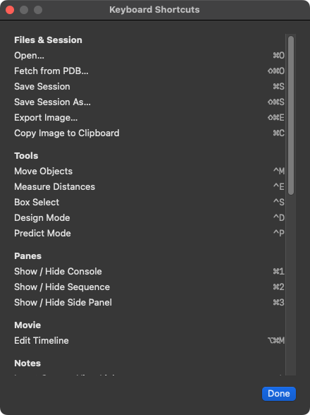
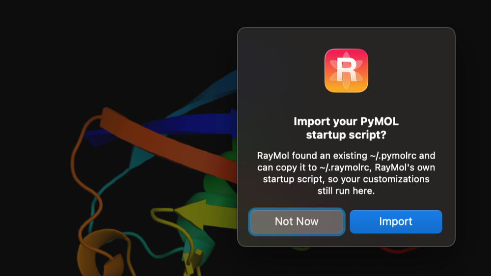

RayMol integrates native macOS and iPadOS keyboard accelerators with PyMOL's command execution system. You can navigate the interface with menu shortcuts, remap viewport operations with `cmd.set_key`, and customize launch behavior using a `~/.raymolrc` startup script.

## Application Keyboard Shortcuts

Shortcuts are listed for macOS. On iPad with a hardware keyboard, ⌃M, ⌃E, ⌃D, ⌃P, ⌘1, ⌘2 and ⌘3 also work; the other shortcuts and the viewport keys are macOS only.


*Help ▸ Keyboard Shortcuts (⌘/).*

### Files & Session

| Command | Shortcut | Description |
| :--- | :--- | :--- |
| **Open…** | `⌘O` | Open a local structure or session file |
| **Fetch from PDB…** | `⇧⌘O` | Download a structure from the RCSB PDB |
| **Save Session** | `⌘S` | Save session (`.pse`) in place |
| **Save Session As…** | `⇧⌘S` | Save session with a new filename |
| **Export Image…** | `⇧⌘E` | Save a PNG of the view at 2× size |
| **Copy Image to Clipboard** | `⌘C` | Copy rendered viewport image to clipboard (or selected text when in a text field) |

### Tools

| Command | Shortcut | Description | Availability |
| :--- | :--- | :--- | :--- |
| **Move Objects** | `⌃M` | Activate 3D Move gizmo | All platforms |
| **Measure Distances** | `⌃E` | Enter interactive measurement mode | All platforms |
| **Box Select** | `⌃S` | Toggle 2D selection marquee | macOS |
| **Design Mode** | `⌃D` | Enter on-device ProteinMPNN sequence design | macOS; iPad/iPhone on iOS 18+ |
| **Predict Mode** | `⌃P` | Enter on-device structure prediction | macOS; iPad/iPhone on iOS 18+ |

### Panes & Views

| Command | Shortcut | Description |
| :--- | :--- | :--- |
| **Show / Hide Console** | `⌘1` | Toggle the PyMOL command terminal |
| **Show / Hide Sequence** | `⌘2` | Toggle the sequence viewer strip |
| **Show / Hide Side Panel** | `⌘3` | Toggle the right-hand inspector column |

### Movie & Notes

| Command | Shortcut | Description |
| :--- | :--- | :--- |
| **Edit Timeline** | `⌥⌘M` | Toggle the movie timeline dock |
| **Insert Camera View Link** | `⌥⌘L` | Insert a camera view link into the active note |
| **Toggle Edit / Preview** | `⌥⌘P` | Switch between Markdown edit and rendered preview |
| **Increase Note Font Size** | `⌥⌘+` | Increase text size in Analysis Notes |
| **Decrease Note Font Size** | `⌥⌘-` | Decrease text size in Analysis Notes |

### Help & Connectivity

| Command | Shortcut | Description | Availability |
| :--- | :--- | :--- | :--- |
| **Keyboard Shortcuts** | `⌘/` | Open the in-app shortcuts cheat sheet | macOS |
| **Enable AI control** | `⌃⌘M` | Toggle the local MCP server for AI tool access | macOS (direct-download build only) |

:::note[Mac App Store builds]
AI control (MCP, `⌃⌘M`) is not included in Mac App Store builds.
:::

## Viewport Navigation & Special Keys

When interacting directly with the 3D canvas (macOS only; viewport keys work while the command line is empty):

| Key | Action |
| :--- | :--- |
| `Tab` | Cycle forward through selection modes (*Atoms → Residues → Chains → Segments → Objects → Molecules → C-α*) |
| `⇧Tab` | Cycle backward through selection modes |
| `Esc` | Leave the active tool; otherwise deselect, then delete `sele` on a second press |
| `←` / `→` | Step through trajectory or movie frames |
| `Page Up` / `Page Down` | Cycle through stored scenes |
| `Home` | Zoom to everything |
| `End` | Play / pause the movie |
| Arrow keys (in **Tools ▸ Enter Lights Mode**, with a light selected) | Orbit (left/right) or pitch (up/down) the selected light by 1° (`⇧`-arrow nudges by 10°) |

## PyMOL Key Bindings & `set_key`

RayMol routes viewport keypresses into PyMOL's internal key mapper. You can assign custom actions to keys using `set_key`:

```text
set_key F1, zoom
set_key F2, orient
set_key CTRL-K, color yellow, sele
set_key ALT-X, hide everything
```

### Key Token Grammar

Key names use PyMOL's set_key syntax:
- Prefixes include: bare (no modifier), `SHFT-`, `CTRL-`, `CTSH-` (Control + Shift), and `ALT-` (Option).
- Special keys are named in lowercase (`left`, `right`, `up`, `down`, `pgup`, `pgdn`, `home`, `end`, `insert`).
- Function keys use uppercase (`F1` through `F12`).
- Bare letters and numbers cannot be bound without `CTRL` or `ALT`, as bare characters are reserved for standard typing.
- The `⌘` (Command) modifier is reserved exclusively for macOS system and application menus and cannot be bound via `set_key`.

### Text Input vs. Viewport Bindings

To protect macOS text-editing conventions and international keyboard layouts:
- **Command line typing**: When the command line or a text field has active focus and contains text, navigation keys (`←`, `→`, `Home`, `End`) and emacs-style editing shortcuts (`⌃A`, `⌃E`, `⌃K`, etc.) act on the text field rather than triggering PyMOL bindings.
- **Option / Alt key behavior**: On macOS, `⌥` (Option) functions as the system character composition key (for example, typing `@` via `⌥L` on German keyboards). Consequently, `ALT-` key bindings fire only when text fields are not focused.
- To enable custom `ALT-` and `CTSH-` shortcuts while typing, turn on **View ▸ Send Key Bindings to Viewport While Typing**. Only bindings you have explicitly customized will be sent to the viewport; stock character composition remains intact.
- **Shortcut shadowing**: If a custom startup script binds a `⌃`-letter shortcut that conflicts with a RayMol menu item (such as `⌃M` or `⌃E`), your script's binding takes precedence for the key, and RayMol logs an audit notice in the console at startup. The menu item remains accessible via mouse click.

## The Startup Script (`~/.raymolrc`)

When RayMol launches on macOS, it automatically looks for and executes a user configuration script. The startup script is macOS only (not iPad or iPhone).

In the direct-download build, the startup script is read from your home folder:

1. `~/.raymolrc.py` (Python syntax)
2. `~/.raymolrc` (PyMOL command syntax)

In the sandboxed Mac App Store build, the home folder is the app container, so put the script in `~/Library/Containers/io.raymol.RayMol/Data/` instead. If both files exist, both run: `~/.raymolrc.py` first, then `~/.raymolrc`.

The startup script executes after default theme initialization, allowing you to set preferences, register custom functions, and bind shortcuts.

### Migrating from `~/.pymolrc`

If you have an existing `~/.pymolrc` or `~/.pymolrc.py` and no `~/.raymolrc` is present, RayMol prompts you on first launch to import your existing settings. If you decline, RayMol records your choice in `~/.raymolrc.skip` and will not prompt you again.


*The one-time prompt to import `~/.pymolrc`.*

### Example `~/.raymolrc.py`

```python
from pymol import cmd

# Configure default representation settings
cmd.set("cartoon_fancy_helices", 1)
cmd.set("cartoon_flat_sheets", 1)
cmd.set("specular", 0.3)

# Define custom key shortcuts
cmd.set_key("F1", lambda: cmd.zoom("visible"))
cmd.set_key("F2", lambda: cmd.orient())
cmd.set_key("CTRL-Y", lambda: cmd.color("cyan", "sele"))

# Custom analysis macro
def show_contacts(selection="sele", cutoff=3.5):
    cmd.select("nearby_waters", f"resn HOH and (({selection}) around {cutoff})")
    cmd.show("spheres", "nearby_waters")

cmd.extend("show_contacts", show_contacts)
```
